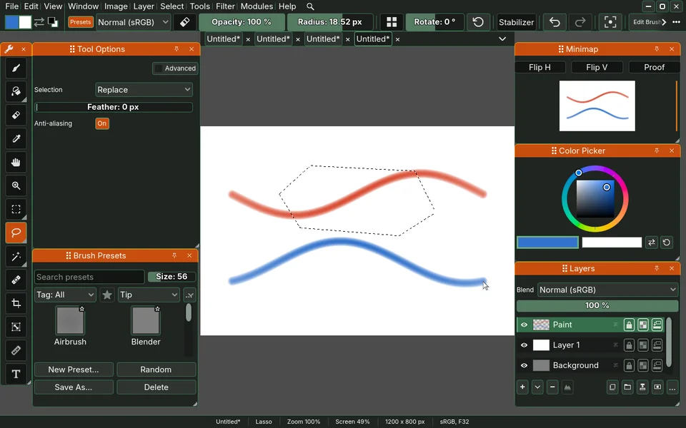

# sara-base-modules

Sara module: base modules.

Each folder here with a `module.gd` is one module. Sara's loader treats a
folder holding a `module.gd` as one module, so a repository is one module or
a folder of them and neither needs telling. A new module starts on a branch of
this repository.

## Modules

- `base/`: Sara's tools, the selections, the fill, the eyedropper, the transform, the move, the navigation and the rest of the toolbox.
- `drifting-sky/`: a paper that moves, a scene layer of drifting sky added from Add Layer and painted over, the example of a module that registers a layer type.
- `exposure/`: the Exposure docker, the view's exposure, the paint's and the active layer's values, each in stops.
- `filter-brush/`: an engine of the Brush that paints the chosen filter's result onto the layer where it passes.
- `image-formats/`: the picture formats Godot reads not at all or not well enough, TIFF, Radiance HDR and OpenRaster, with a table of what each does in its README.
- `kaleidoscope/`: a filter that mirrors the picture around a centre, with a widget of its own, presets and a pass that reads the whole layer.
- `language-en-us/`: American English, one catalogue that respells Sara's British sentences.
- `linux-pen/`: the pen read from the Linux kernel itself, so a barrel button let go in the air is heard.
- `midi/`: knobs, faders and keys of a MIDI controller drive the sliders, brush presets and filters they are mapped to.
- `sphere/`: the Sphere docker, the panorama on a ball seen from outside, turned by a drag, for judging it as a light source.
- `stamp-brush/`: the stamp brush engine, a stroke laid as dabs of a tip, with the eraser that shares it.
- `stats/`: the Stats docker, numbers about the picture computed only while it is open.
- `text/`: text layers, point text a painter clicks and types, in Source Serif 4, Comic Neue, Caveat or a font file of their own, drawn from the glyphs' outlines and kept in the .sad as they were set.
- `vector/`: vector layers, rectangles and ellipses with a float fill and stroke, drawn on the GPU at exact coverage, moved and resized by their handles and kept as their numbers.

## Native code

`tiff-lzw/` holds no `module.gd`. It is native code, the GDExtension
`SaTiffLzw`, which unpacks a TIFF strip compressed with LZW about thirty times
as fast as GDScript, and `SaTiffSamples`, the passes `SaTiffReader` makes over
every sample once a strip is unpacked (byte order, predictor, scaling of
integers and an associated alpha). `SaTiffUnpacker` in `image-formats/tiff/`
asks for the library by name and both classes fall back to GDScript when it is
not there, so a checkout that never built it opens the same files, slower.
The skeleton's `packaging/build.sh modules` builds its Linux library and
cross-builds its Windows one with llvm-mingw against godot-cpp, and writes
`sara_tiff_lzw.gdextension` naming what it built. Neither the libraries nor
that file are committed.

## What a module may put beside its script

**`layouts/`, a folder of docker layouts.** Every `.cfg` in it is offered to
the painter under `<module id>/<file name>`, listed after the four the
skeleton ships and before the painter's own, and it is read-only for the same
reason those four are: it lives inside the module, which is inside the
exported PCK. An edit made while one of them is in use forks it under
`<module id>_<file name> (custom)` into the painter's own layouts folder, the
underscore because a file name cannot hold the slash the list shows. No module
here ships one yet. `sara-godot/tests/fixtures/modules/layout-fixture` is a
module that does nothing else, and
`sara-godot/scenarios/module-ships-layouts.json` drives the real app against
it.

A layout file is the same shape the skeleton's own are, `sara-godot/layouts/`
being four worked examples: a `[_layout_meta_]` section carrying `os_scale` and
`preset`, then one section per docker with its `position`, `size` and `visible`.

## Tests and shaders

`base/tests/`, `stamp-brush/tests/` and `filter-brush/tests/` are run by the
skeleton's own runner, which discovers a module's suites at
`modules/<name>/tests`. The shaders under `stamp-brush/shaders/` and the one in
`filter-brush/` are compiled through the skeleton's shader index, which derives
a kernel's owner from the directory under `modules/`, so every module here
shares the owner name `sara-base-modules` and a kernel name has to be unique
across them.

## Filter behaviour worth knowing

Notes on what some `base/shaders` filters do, for a reader of the Filter menu
rather than of the kernel.

- **OpenDRT** takes the document's own linear RGB as input, so it has no input
  row. Its display encoding is sRGB Display (Rec.709 primaries, 2.2 power,
  bright surround), but the 2.2 power is left to the canvas view, because the
  document stores linear light and the view encodes it. With `oklab_hue` off it
  computes what the original DCTL computes, so a preset can be matched against
  Resolve. It adds C, M and Y Brilliance windows, a per-channel switch on
  Contrast Low and a `pt_enable` gate on the purity limit, all defaulting to the
  original's numbers.
- **Add Noise** draws from the document pixel and the seed alone, so noise does
  not crawl when the painter strokes beside it. Monochrome draws one grain for
  all channels and White leaves it in the document's own values, while the grain
  colour tints the light the grain adds or takes away. Shadows weighs the grain
  by Oklab lightness, and for Salt and Pepper it sets how often a texel is hit.
  Every kind is scaled by the texel's alpha, so an unpainted texel stays empty.
- **Hot Pixels** replaces a texel that is further than the threshold from all
  eight neighbours with their per-channel median. Two bright texels side by side
  are not hot, and a neighbour past the canvas is left out of the judgement.
- **Wavelet Denoise** shrinks each detail level with the non-negative garrote,
  which keeps hard edges within a hundredth where a soft threshold would dull
  them.
- **Lens Correction** uses the first radial term of the Brown-Conrady model about
  the document's centre. Crop to fill zooms in by the least factor that shows no
  edge from outside the document.
