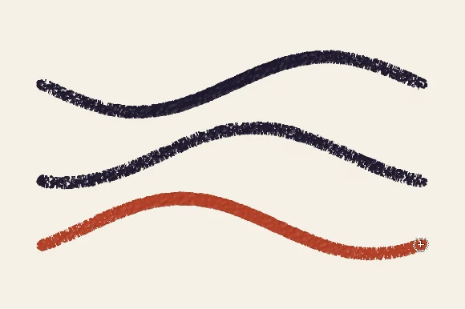
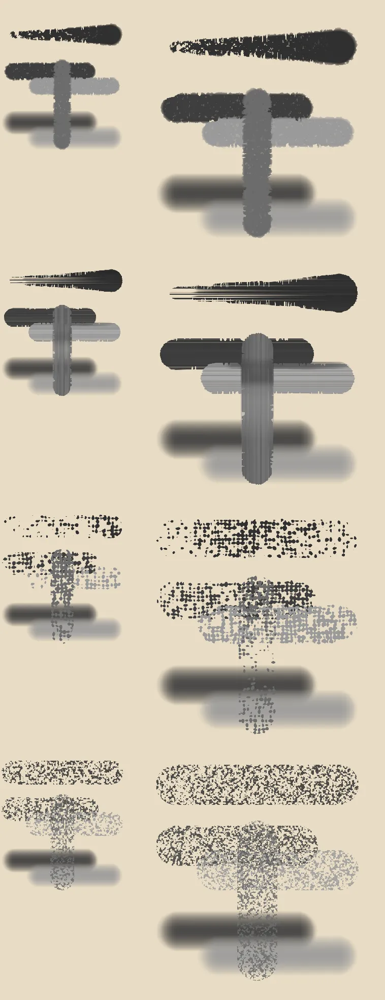

# sara-noise-brush-engine

Sara module: noise brush engine. A brush engine whose stroke the paper
decides, one smooth stroke shaped by a noise texture and the pressure.

<p align="center"></p>

The module registers its engine, its fields and its presets through Sara's
door like any other module, see `manifest.cfg` for its version.

## What it does

A stamp brush lays a dab, moves on and lays another. The noise brush lays one
continuous stroke, and a field decides where inside that stroke the paint
takes. Each point of the stroke has a pressure it needs before it takes paint.
A light touch fills only the points that need little, and a hard press fills
nearly all of them, so the same stroke is speckled when it is pressed lightly
and solid when it is pressed hard. A second reading of the field is the height
the paint stands to, which the Thickness and Relief rows turn into relief.

## The fields

A field is what the stroke is read through. The Texture page of the brush
editor chooses one, and the numbers beside it belong to that field.

| Field | What it does | Its rows |
| --- | --- | --- |
| Grain | Value noise, an isotropic speckle like paper tooth or pencil grain. | Scale (the width of a speck in pixels), Contrast (a soft haze at the low end, a hard pepper at the high end) |
| Bristle | Streaks that run along the stroke like the hairs of a loaded flat. A light touch lays the thinnest hairs and a hard press closes the gaps. | Count (streaks across the stroke), Spread (how far each strays from an even comb), Length (how far a streak runs before it breaks) |
| Picture | Any pattern from Sara's patterns folders or your own, tiled along the stroke, so a woven canvas takes paint on its threads. | Pattern, Scale, Rotation, Invert |

Grain and Bristle have two channels, a second reading for the height. A
Picture has one, because a pattern is decoded to one grey mask.

<p align="center"></p>

The picture is made by a real Sara through its scripting door. Each row is one
preset, painted at a medium and a large size with a ramp of rising pressure, two
overlapping strokes and a drag across them.

## Presets

The module ships its presets in the Brush Presets docker. Three
that show the fields:

- **Grain Round** paints through a fine paper grain, speckled at a light touch
  and solid at a hard press, for laying in colour with a tooth to it.
- **Bristle Flat** drags long streaks with the stroke the way a loaded flat's
  hairs do, for blocking in and for hair and grass.
- **Canvas Scumble** breaks paint over a woven canvas pattern, the threads
  taking it and the hollows left open, for scumbling one colour over another.

A preset stores the field's name in its `texture_field` setting and the
field's numbers under keys of their own, so saving a preset keeps both.

## Your own field

A field is one function in a `.gmacs` file. Save it in the `brush-fields/noise/`
folder of Sara's data folder and Sara reads it when the next stroke starts, so
there is no restart. The file's name is its id, and comment lines at the top
may name it and its numbers:

```
# Field: Ripples
# Number: Period, 2, 64, 12
# Number: Contrast, 0, 4, 1

def brush_field(float along, float across, float half_width, vec3 numbers, vec2 offset) -> vec2:
    float needed = fract((along + offset.x) / max(numbers.x, 2.0)) < 0.5 ? 0.0 : 1.0
    return vec2(needed, 1.0 - needed)
```

`along` is the distance in pixels travelled on the path, `across` runs from
minus one at one edge of the stroke to one at the other, and `half_width` is
the brush's half width in pixels. `numbers` holds the field's rows in order
and `offset` is two numbers drawn once for each stroke, to add wherever two
strokes should not lay one pattern. The function answers two readings from 0 to
1, the pressure a point needs before it takes paint in x and the height it
stands to in y. The file above lays bands across the stroke, the first half of
each band taking paint at any pressure.

A file that does not compile is skipped with one line in the log naming the
file and the first error, and the other fields stay.

## Registering a field from a module

A module can bring a field in the same way this module registers its own three.
Depend on `sara-noise-brush` and register through the door:

```gdscript
extends SaModule

func get_dependencies() -> PackedStringArray:
    return PackedStringArray(["sara-noise-brush"])

func register(ctx: SaContext) -> void:
    ctx.register_brush_field(
        SaBrushFieldRegistry.Field.new(
            "bands", "Bands", &"noise", SaBrushFieldRegistry.OWN, 1,
            [&"bands_period"], [], PackedFloat32Array([12.0]),
            "res://modules/my-module/bands_field.gmacs"
        )
    )
```

The arguments are the id, the label of the Texture row, the engine (`noise`),
the kernel (`OWN` for a field that brings its own GLSL), the channel count, the
settings keys the numbers are read from, the extra rows, the fallback for each
number and the path of the `.gmacs` file with the same `brush_field` function.

## How a stroke is laid

The engine paints the stroke as a stretch of path an update at a time. The
reasons behind the shape of that code:

- **One stroke, never stamps.** A texel takes the tip at its nearest point of
  the path, so the shape is the tip dragged and nothing has the period of a dab.
- **A point is taken only a step on from the last.** A pen reports a wobble of
  about a pixel at every sample, and reading the field along each wobble filled
  the holes of a light stroke. The points between two steps are held back.
- **A round tip holds back half a width**, so a turn is drawn round a pivot on
  its inside, which the update that reaches the joint cannot know yet.
- **A tip that is not round carries a trail**, because a centre that matters
  can be a tip's reach behind the texel.
- **Each texel is painted once across updates**, so the relief shows no joint
  between two updates.

## What a painter sees in a stroke

The kernel is `noise_dab.gmacs`. What follows is the behaviour a painter
sees, and the decisions behind it are in the file headers.

- **The stroke is a swept shape.** Each texel takes the tip at its nearest
  point on the path, so the shape is the tip dragged, never a row of dabs.
- **The pressure is the cut.** The field is a pressure map. A texel paints
  fully where the pressure reaches the field's value and not at all where the
  value stands more than the band above it, so a light touch is opaque with
  holes rather than translucent. Strength shifts the map against the pressure,
  and Hardness softens the edge of the holes without changing which texels a
  pressure fills.
- **Hardness thins the grain towards the rim**, by a smoothstep from all of it
  to none, and Rim Firmness narrows the band the rim thins over, so a brush
  can keep a soft cut and a firm edge.
- **A wash until the pen comes back.** One pass lays the strongest alpha it
  gives a texel, and a scrub over paint the stroke laid a tip and a half of
  travel before builds up, capped at one.
- **The lightness is the bump.** It goes into the layer's height and never
  into the colour, scaled by the Thickness row.
- **Old paint is pushed ahead.** The stroke picks up the surface and the
  paint it crosses across its whole width and lays them ahead of it, fading
  over three tip radii. With Push Colour Below on, paint on the layers
  beneath is carried where the layer's own is bare. Flat fills have no body
  and are never pushed.
- **A hard press piles paint at the stroke's edges** above a pressure
  threshold, and a light one leaves nothing.
- **A leaning pen lays more on the side it leans to**, a straight ramp of
  height across the tip scaled by the Thickness Lean row.
