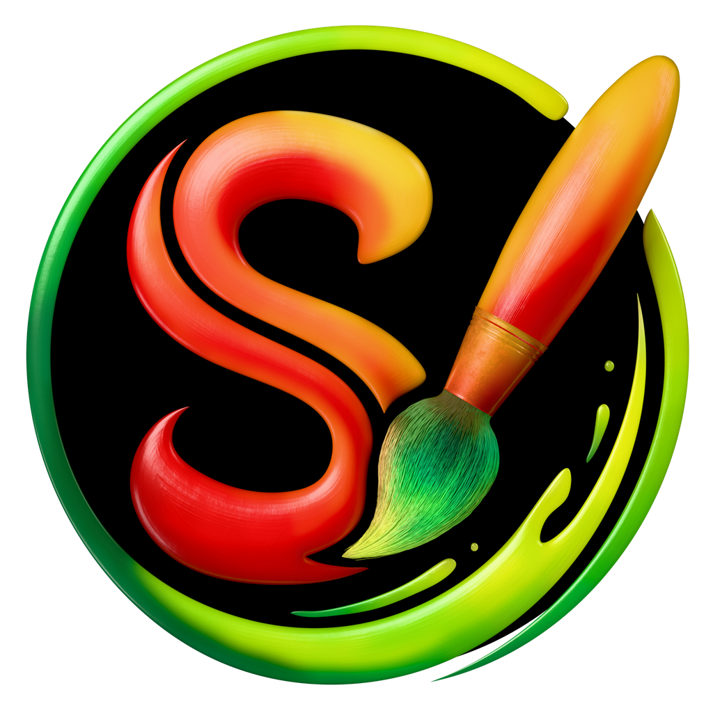
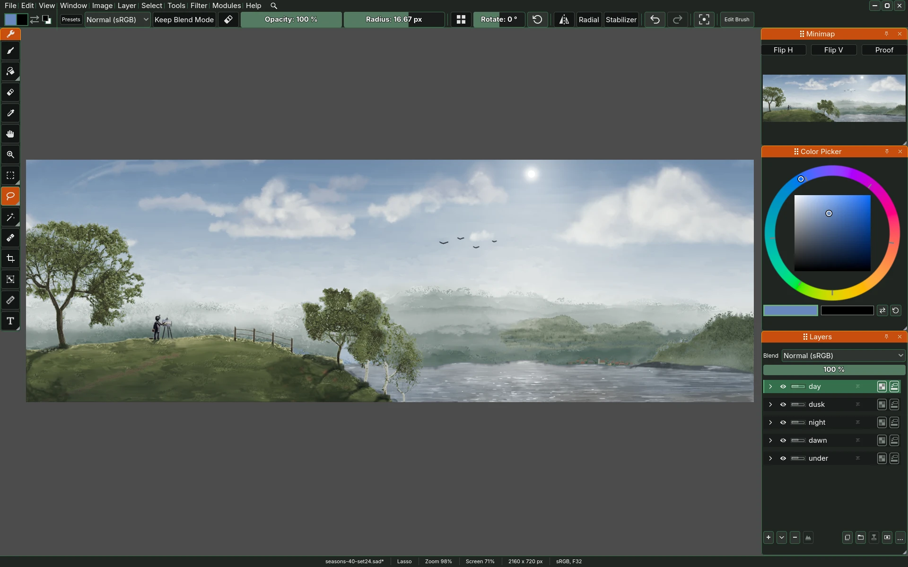
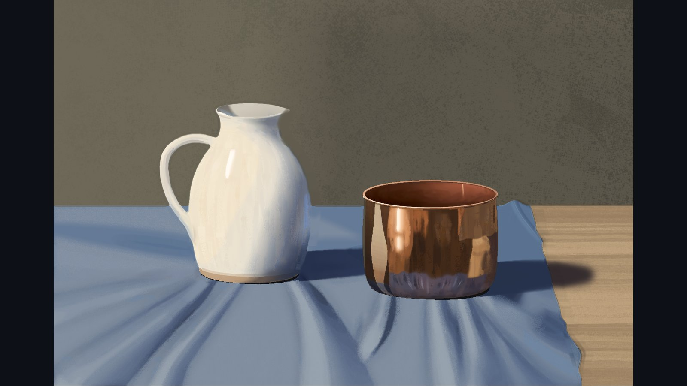
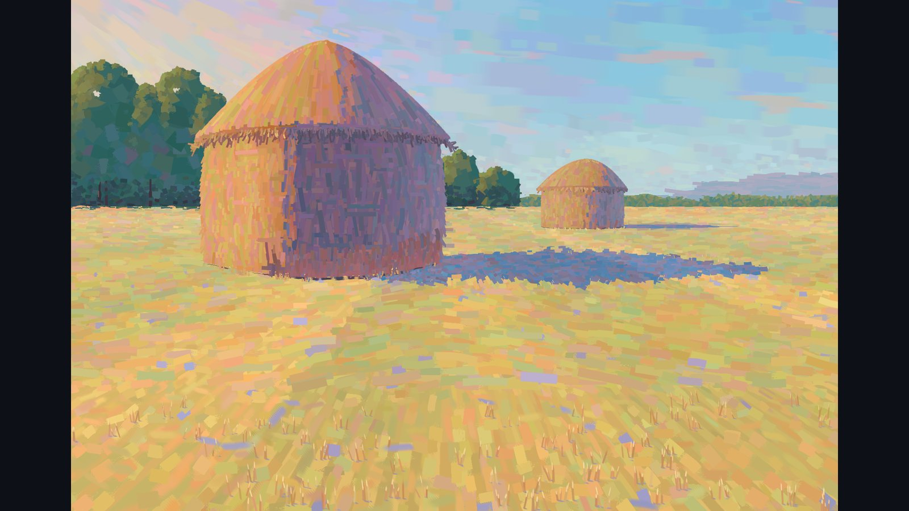
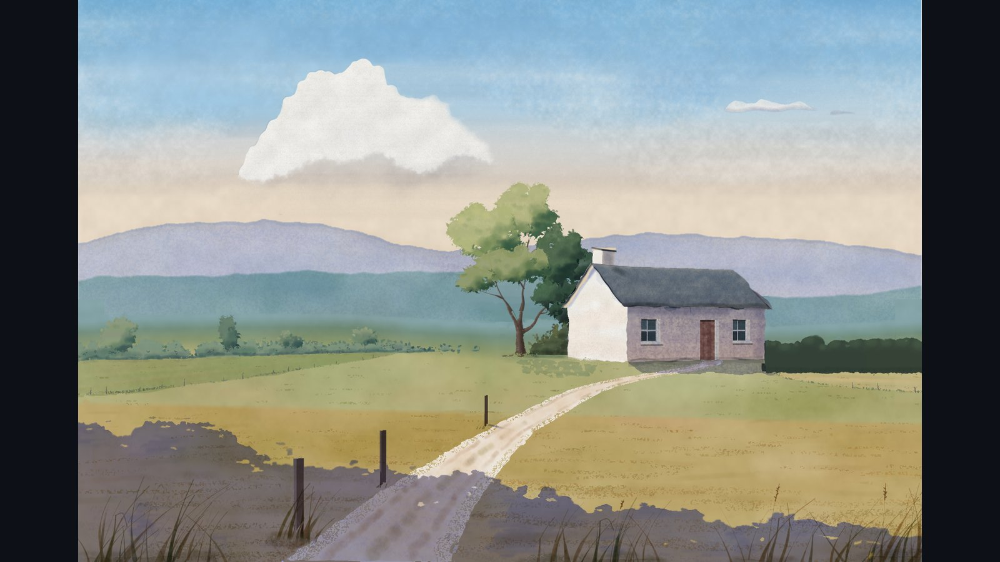
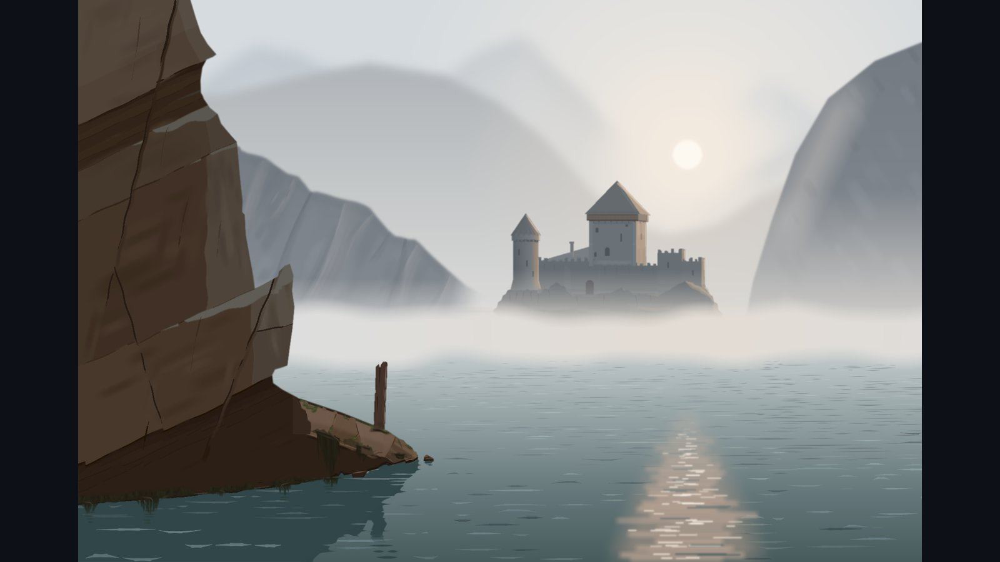

  

<h1 align="center">Sara</h1>

  A digital painting application.

  
  
  
  

  <b><a href="#download">Download Sara</a></b>
  &nbsp;·&nbsp;
  <a href="CONTRIBUTING.md#building-sara">Build it yourself</a>
  &nbsp;·&nbsp;
  <a href="https://discord.gg/DHxbD7m6y">Talk to us on Discord</a>

---

Sara is a painting program for artists. It paints on the graphics card, and it
keeps HDR data, so the light you paint with stays as you left it: brights bright
and darks dark, even above white. Every tool and filter is a module, so you can
switch off what you do not use. Krita presets and bundles import, and a Blender
connection is planned.

  

---

## Download

Take the file for your system from the table, and the newest release is the
one it links. Every version is also on the **[Releases page](https://github.com/MatejZeman02/sara/releases)**,
under **Assets**. The **Source code** zips GitHub adds to every release are not
Sara to paint with, they are for building it.

| System                       | File                                  | How to start it                                                                                                       |
| ---------------------------- | ------------------------------------- | --------------------------------------------------------------------------------------------------------------------- |
| **Windows** 10 or 11, 64-bit | [`sara-windows-x86_64-v1.0.0-alpha.1-7d35bab-release.zip`](https://github.com/MatejZeman02/sara/releases/download/v1.0.0-alpha.1/sara-windows-x86_64-v1.0.0-alpha.1-7d35bab-release.zip) | Unpack the whole zip into a folder of its own (right-click, **Extract All**) and double-click `sara.exe` inside it.   |
| **Android** tablet           | [`sara-android-v1.0.0-alpha.1-7d35bab-debug.apk`](https://github.com/MatejZeman02/sara/releases/download/v1.0.0-alpha.1/sara-android-v1.0.0-alpha.1-7d35bab-debug.apk)          | Copy it to the tablet and tap it. Android asks to allow installs from that source once.                               |
| **Linux**, x86_64            | [`sara-linux-x86_64-v1.0.0-alpha.1.AppImage`](https://github.com/MatejZeman02/sara/releases/download/v1.0.0-alpha.1/sara-linux-x86_64-v1.0.0-alpha.1.AppImage)| Make it executable (`chmod +x` and its name, or tick **Allow executing** in its file properties) and double-click it. |

> [!NOTE]
> - **The first start** is slower while Sara prepares its brushes for your
>   graphics card.
> - **macOS** is untested rather than unsupported.
> - Sara also needs a **Vulkan** graphics card. On a laptop with **two** cards,
>   run it on the discrete one.

<b>Windows says "Windows protected your PC"</b>

Sara is not signed yet. Check the zip with your antivirus first, then click
<b>More info</b> and <b>Run anyway</b>.

<b>The Linux AppImage does not start</b>

Your system may lack FUSE 2. Install the package <code>libfuse2</code> (Ubuntu 22.04 and
later leave it out), or start the file with <code>--appimage-extract-and-run</code>.

The Windows zip and the Linux `.tar.gz` come in two builds, and the last word
of the name says which.
Both read the same settings, brushes and paintings.

| Build       | What for                                               |
| ----------- | ------------------------------------------------------ |
| **release** | Painting. It starts sooner and paints a little faster. |
| **debug**   | Bug reports. Its log names the line that failed.       |

- **Android** is an early test build, and its layout is not made for a tablet yet.
- **Linux** also comes as `sara-linux-x86_64-...-release.tar.gz`, for a system
  where the AppImage does not run. Unpack it and start `sara.sh` inside.
- `sara-python-...zip` is the Python client, `sara.py`, for notebooks and
  scripts. Every download above carries it beside Sara as well. Python itself
  is not included.
- Every download carries `README.txt`, a one-page guide to the first start,
  where Sara keeps your files and how to send a bug. Here it is
  [`packaging/painter-guide.txt`](packaging/painter-guide.txt).

---

## Where Sara keeps its files

Your paintings are wherever you save them. Everything else is in two folders.

| System | Settings, shortcuts and layouts | Brushes, colours, recovery copies and logs |
|---|---|---|
| **Linux** | `~/.config/sara` | `~/.local/share/godot/app_userdata/Sara` |
| **Windows** | `%APPDATA%\sara` | `%APPDATA%\Godot\app_userdata\Sara` |
| **macOS**, untested | `~/Library/Application Support/sara` | `~/Library/Application Support/Godot/app_userdata/Sara` |
| **Android** | The app's own storage | The app's own storage, with the log and notes in `Documents/Sara` |

On Linux both folders follow `XDG_CONFIG_HOME` and `XDG_DATA_HOME` when you
set them, and are the same on every distribution. The log is `godot.log`, one
per run, with the nine runs before it kept beside it.

---

## Features

Several of these are ideas other painting programs lack, or have only in
part:

| Feature                      | Description                                                                                                                                                                                                                             |
| ---------------------------- | --------------------------------------------------------------------------------------------------------------------------------------------------------------------------------------------------------------------------------------- |
| **HDR colour range**         | ✅ Values above white and below black survive painting, compositing and export. Each painting carries its own colour range, white point and tone curve.                                                               |
| **Noise brush engine**       | ✅ One smooth stroke that a paper texture breaks up. Press lightly and it speckles like pencil grain, press hard and it fills in.                                                                                                                                                                        |
| **Impasto and relief light** | ✅ Paint has height, lit live on the canvas from a light you turn, and a flat export can bake the light in.                                                                                                                              |
| **Double resolution layer**  | ✅ One layer painted at twice the document's detail, shown when you zoom in, and baked down in one step.                                                                                                                                 |
| **Infinite canvas**          | 🟡 Paint past the edge of the document, and the canvas grows only where paint lands. Strokes run past the edge, and the composite and the export still cover the document.                                                              |
| **Every tool is a module**   | ✅ Switch any tool or filter off, or add your own through the same door the built-in ones use.                                                                                                                                           |
| **Filters in a few lines**   | ✅ A filter is a short pixel function that runs on the graphics card. Sara can also be driven from Python or a Jupyter notebook, and the course notebooks are in [2D-effects-course](https://github.com/MatejZeman02/2D-effects-course). |
| **Spectrogram**              | ✅ Read the picture's texture and detail at every scale in the Graph docker.                                                                                                                                                             |

✅ built, 🟡 partly built.

<b>And a few more things:</b>

<table>
  <tr>
    <th width="28%">Feature</th>
    <th>Description</th>
  </tr>
  <tr>
    <td><b>Krita brushes</b></td>
    <td>✅ Krita presets and bundles import and paint the way Krita paints them, with ten brush slots and a pop-up palette to match.</td>
  </tr>
  <tr>
    <td><b>Drawing assistants</b></td>
    <td>✅ A ruler, a vanishing point, a parallel ruler and an ellipse hold your strokes to a shape.</td>
  </tr>
  <tr>
    <td><b>Liquify and the filter brush</b></td>
    <td>✅ Push, twirl, shrink and grow paint, or paint a filter's result where the brush passes.</td>
  </tr>
  <tr>
    <td><b>Filters that change over time</b></td>
    <td>✅ Play or scrub a filter through time, or run a simulation such as Game of Life or Gray-Scott on a layer.</td>
  </tr>
  <tr>
    <td><b>Panoramas painted from inside</b></td>
    <td>✅ Paint the whole sky around you and wrap around, with strokes that cross the seam whole.</td>
  </tr>
  <tr>
    <td><b>Select Subject</b></td>
    <td>✅ One click selects the subject of a photograph. Sara asks before it downloads the small model, once.</td>
  </tr>
  <tr>
    <td><b>MIDI control</b></td>
    <td>✅ Knobs, faders and pads on a MIDI controller turn Sara's values and choose brushes.</td>
  </tr>
  <tr>
    <td><b>Soft proof</b></td>
    <td>✅ See a picture in a narrower colour range before you export.</td>
  </tr>
  <tr>
    <td><b>Reference board</b></td>
    <td>✅ A Reference docker keeps pictures beside the canvas. Paste them in or drop them from a folder.</td>
  </tr>
  <tr>
    <td><b>Layers other programs can open</b></td>
    <td>✅ Open and save TIFF and OpenRaster, so layers move between Sara, Krita, GIMP and MyPaint. Open Radiance HDR, save EXR, and save lossless as JPEG XL.</td>
  </tr>
  <tr>
    <td><b>Text</b></td>
    <td>🟡 Click and type, in the shipped fonts or one of your own. For now one font, size and colour per text, and bold, italic, alignment and spacing come later.</td>
  </tr>
  <tr>
    <td><b>Sara in Czech</b></td>
    <td>🟡 The interface in Czech, switched live, as a module. It is a machine draft, checked only in part.</td>
  </tr>
</table>

The **stamp brush** follows Krita's pixel brush engine, its settings, its
dynamics and its preset format. The **noise brush**, with its impasto, is
Sara's own.

### Planned

<table width="100%">
  <tr>
    <td width="50%"><b>Animation workflow</b></td>
    <td width="50%"><b>Blender connection</b></td>
  </tr>
  <tr>
    <td><b>A canvas that grows and exports with the painting</b></td>
    <td><b>Vector shapes and paths</b></td>
  </tr>
  <tr>
    <td><b>Typeset text</b></td>
    <td><b>Photoshop files and brushes</b></td>
  </tr>
  <tr>
    <td><b>Layered EXR files</b></td>
    <td><b>Mac and iPad builds</b></td>
  </tr>
  <tr>
    <td><b>Interactive painting lessons</b></td>
    <td><b>Realistic pigment mixing</b></td>
  </tr>
  <tr>
    <td><b>Realistic simulated brushes</b></td>
    <td></td>
  </tr>
</table>

The manual comes with Sara as **Help > Manual** (F1). In the repository it
starts at [`sara-godot/manual/01-the-window.md`](sara-godot/manual/01-the-window.md).

---

## Help and bugs

Questions, pictures and bugs are welcome on
**[Discord](https://discord.gg/DHxbD7m6y)**. A bug can also go to the
repository's [Issues](https://github.com/MatejZeman02/sara/issues).
Inside Sara, **Help > Take a Note** (Ctrl+Alt+N) writes down what you saw with
a picture of the window, ready to send.

---

<table>
  <tr>
    <td width="50%"></td>
    <td width="50%"></td>
  </tr>
  <tr>
    <td></td>
    <td></td>
  </tr>
</table>

---

## For developers

Sara is written in Godot (no C#), built for Windows and Linux from Linux, and for
Android tablets. It is developed and tested on Fedora with GNOME under native
Wayland. Without Vulkan, Sara starts but cannot paint, and at every start it
writes the verdict to its log on the line that starts with **Floor**.

Tools and filters register through the same public door a module of your own
would use, and **Preferences > Modules** switches any of them off. A filter is a
short pixel function in
[`.gmacs`](https://github.com/MatejZeman02/gmacs-acompute-syntax-highlighting-vs-code-extension),
and the door runs from Python and Jupyter notebooks, with the (Czech) course
notebooks in [2D-effects-course](https://github.com/MatejZeman02/2D-effects-course).

Building, the tests and the rules the code follows are in
[`CONTRIBUTING.md`](CONTRIBUTING.md). [`packaging/README.md`](packaging/README.md)
describes the build scripts, [`packaging/agent-guide.md`](packaging/agent-guide.md)
the door, and [`sara-godot/scripts/sara.py`](sara-godot/scripts/sara.py) is the
door as a Python client.

A few modules are held back while they are finished: paint mixing, a live
Blender layer, lessons and a drifting sky. They join public builds as they are
ready.

---

## Licence and credits

Designed by **Matěj Zeman**, written with the help of AI coding agents.
Released under the **GPLv3**. Based on:

- **Godot Engine**, (c) 2014-present Godot Engine contributors. MIT.
- **Acerola Compute**, compute shader wrapper infrastructure that the `.gmacs`
  format and `SaCompute` are based on, by Garrett Gunnell. MIT.
- **Oklab**, colour appearance model by Björn Ottosson. MIT.
- **darktable**, (c) 2011-2026 the darktable developers. Much of how Sara
  treats colour comes from darktable's way of working: values kept above white
  and below black instead of clipped, and adjustments shaped on light rather
  than on screen values. The Graph docker's waveform, vectorscope and
  histogram are drawn the way darktable's scopes read, and White Point,
  Exposure and Brightness/Contrast take their shapes from its modules. Two
  small formulas are taken from its code, the negative-channel net of its
  sigmoid module and its vectorscope's log radius. GPL-3.0-or-later.
- **Blender**, the Blender Foundation and its contributors. Sara shares
  Blender's view of a picture as light: a render opened here keeps its values
  above white, and colour works on scene light before it is shown. The
  colour ramp, the gradient's noise and pattern textures, the slider that a
  right press or Escape puts back, the panorama's orientation and the
  numbered backups of a saved file follow Blender's. Ideas and conventions
  only, no code. GPL-2.0-or-later.
- **Krita**, (c) 1999-2022 the Krita contributors. The stamp brush was written
  against Krita 5.2.13's pixel brush engine, from what its mechanisms do rather
  than from its code. Five small ports remain, tuned formulas and constants,
  each carrying Krita's copyright lines verbatim. GPL-2.0-or-later.

See [`LICENSE`](LICENSE) for the GPLv3 text and [`THIRDPARTY.txt`](THIRDPARTY.txt)
for every library in a build, with its copyright and licence.
