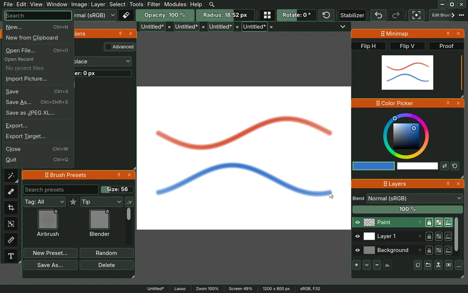

# sara-jxl, the JPEG XL codec for Sara's save

A GDExtension, built for the Godot version Sara builds with (`config/features`
in `project.godot` and `GODOTCPP_API_VERSION` in `CMakeLists.txt` name it),
that codes one field of one chunk of a Sara document (`.sad`) to a lossless
JPEG XL codestream and back, for File > Save as JPEG XL. Ctrl+S and the autosave stay on Zstd.

<p align="center">
 Save as JPEG XL in Sara's File menu">
</p>

This branch, `sara`, holds the module alone and is the one Sara takes as a
submodule. The measurements that chose it, the timing demo and the design of
the save in Sara are on the branch `main` of the same repository. A change to
the module is committed here and merged into `main`.

> [!NOTE]
> The Windows library is built on Linux with llvm-mingw and checked on
> Windows separately. See "Build" below.

## What is here

| Path | What |
| --- | --- |
| `src/` | the GDExtension, one class `SaJxl` |
| `CMakeLists.txt` | its build, against godot-cpp, with libjxl built statically into it |
| `sara_jxl.gdextension` | the file Godot loads the module by, written by the build to name the libraries in `bin/`, and not in the repository |
| `cmake/write_gdextension.cmake` | what writes it |
| `module.gd` | registers the codec `jxl` through Sara's door when the library loaded |
| `patches/` | libjxl patches, five speed-ups that leave every stream byte for byte libjxl's own, `effort7-switches.patch`, which lets effort 8 take some of effort 7's choices, and `lean-fixed.patch`, which lets the build fix which |
| `scripts/fetch_libjxl.sh` | clones libjxl at the tag the script's `LIBJXL_TAG` names, with the libraries it bundles and applies `patches/` |
| `cmake/llvm-mingw.cmake` | the toolchain file for the Windows library, built on Linux |

## The interface

One class, `SaJxl`, with four static methods and no state, so a save may
call it from every worker thread at once:

- `SaJxl.encode(texels, width, height, channels, bytes_per_channel, effort, options) -> PackedByteArray`
  codes one field of one chunk. `texels` are the texture's bytes as Sara
  reads them back, 1 or 4 channels of half or full floats, straight alpha.
  Every float comes back bit for bit, negative values, values above 1 and
  colour under alpha 0 included. Full floats are declared only as wide as
  their widest mantissa, so colour a save rounded to 12 bits costs about half
  what it would at 32. `options` maps a `JxlEncoderFrameSettingId` to its
  value. An empty result means libjxl refused.
- `SaJxl.encode_for_save(texels, width, height, channels, bytes_per_channel) -> PackedByteArray`
  is `encode` at the save's setting, lean effort 8, the one a save calls.
  The build fixes part of the setting inside libjxl, so in this module
  `encode` at effort 8 is lean too.
- `SaJxl.decode(stream, width, height, channels, bytes_per_channel) -> PackedByteArray`
  gives the texels back, or an empty array when the stream is not that image.
- `SaJxl.libjxl_version() -> int`.

## Build

`L` is any folder for the sources and the builds. libjxl is built inside
the module's own build, statically, so the library needs nothing beside it.

```bash
scripts/fetch_libjxl.sh $L/libjxl
git clone --depth 1 https://github.com/godotengine/godot-cpp.git $L/godot-cpp
cmake -S . -B $L/build-linux -DGODOT_CPP=$L/godot-cpp -DLIBJXL=$L/libjxl \
  -DCMAKE_BUILD_TYPE=Release -DGODOTCPP_TARGET=template_release
cmake --build $L/build-linux -j 4
```

The Windows library, on Linux, with
[llvm-mingw](https://github.com/mstorsjo/llvm-mingw) unpacked at `$M`:

```bash
PATH=$M/bin:$PATH cmake -S . -B $L/build-windows \
  -DCMAKE_TOOLCHAIN_FILE=cmake/llvm-mingw.cmake -DGODOT_CPP=$L/godot-cpp \
  -DLIBJXL=$L/libjxl -DCMAKE_BUILD_TYPE=Release -DGODOTCPP_TARGET=template_release
PATH=$M/bin:$PATH cmake --build $L/build-windows -j 4
```

Both land in `bin/`, and each build writes `sara_jxl.gdextension` naming
the libraries `bin/` holds. A checkout that never built one has no such file,
so Godot loads nothing and prints nothing, where a file naming a missing
library would print three errors at every launch. One
release library a platform serves the editor, a debug export and a release
export alike.

## The first open of a project

> [!WARNING]
> Godot, at the version Sara builds with, aborts on exit (status 134 and a core dump) from the first
> open of a project that has no `.godot/extension_list.cfg` yet, when it
> finds this module during that first scan. The run's own work is done and
> the list is written, so every later run starts with the module loaded and
> exits cleanly. It is Godot's or godot-cpp's, not the module's: the smallest
> godot-cpp extension with one class does the same, built for
> `template_release`, `template_debug` or `editor` alike, and an extension
> that registers no class does not.

To keep the first run clean, write the list before it:

```bash
mkdir -p PROJECT/.godot
echo "res://modules/sara-jxl/sara_jxl.gdextension" > PROJECT/.godot/extension_list.cfg
```
