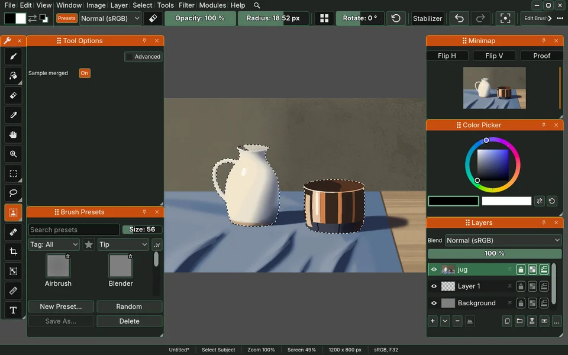

# sara-background-removal, Select Subject for Sara

The Select Subject tool, whose click selects the subject of the picture with
U²-NetP, a small network its authors trained to find the salient object of a
photograph.

This is the repository `sara-background-removal`, which Sara takes as the
submodule `sara-godot/modules/sara-background-removal`. It sits outside the
base modules, so a Sara without it still has the wand, Colour Range and the
quick mask, and has no Select Subject tool.

## The weights

The module ships no weights. Choosing the tool with none kept opens a dialog that says where the
file comes from, the authors' own Google Drive link in the README of
`xuebinqin/U-2-Net`, its size, 4,683,258 bytes, and what is known of its
licence: the code is Apache 2.0, the weights carry no statement of their own,
and the training data, DUTS-TR, is "All rights reserved by the original
authors". Accept downloads the file into the module's data folder, under the
data root `--settings-dir` moves, and keeps it only when its SHA-256 is
`e7567cde013fb64813973ce6e1ecc25a80c05c3ca7adbc5a54f3c3d90991b854`. After that
the tool asks the network nothing again. Cancel puts the tool in hand before
back in hand.

Two arguments after the `--` of Sara's command line point the download
elsewhere, for a suite or a mirror: `--background-removal-source=<url>` and
`--background-removal-sha256=<hex>`.

## What is here

| Path | What |
| --- | --- |
| `module.gd` | registers the Select Subject tool and the command that puts it in hand through Sara's door, the facade, opens the dialog when the tool is chosen with no weights, and holds the file's source, size and hash |
| `select_subject_tool.gd` | the tool's state on each surface: a click, Shift adding and Alt subtracting, handed to the module |
| `icons/select_subject.svg` | the tool's icon, a figure in a selection's corners |
| `weights_dialog.gd` | the dialog of the first use: source, size, licence, Accept and Cancel, and the bar |
| `weights_download.gd` | one download: the request, its progress, the hash, and the file kept or nothing |
| `pth_reader.gd` | reads the weights file, PyTorch's legacy format, with a pickle machine of its own that checks every opcode and global before it runs one and calls nothing |
| `folded_weights.gd` | folds every batch norm into the convolution before it and uploads the weights and biases once, as one storage buffer with a table of where each starts |
| `network/subject_network.gd` | U²-NetP as a chain of Sara's kernels over the folded weights: the plan of every step, the pages the intermediates live in, and a run as one submission |
| `network/subject_convolve.gmacs` | a 3×3 convolution at any dilation or a 1×1, its bias and ReLU fused, over one tensor or two read as their concatenation, with the residual add |
| `network/subject_pool.gmacs` | the 2×2 max pool with stride 2, rounding up |
| `network/subject_resample.gmacs` | bilinear resampling with the corners unaligned, as `F.upsample` has it |
| `network/subject_sigmoid.gmacs` | the sigmoid of the fused output, kept as it is |
| `selection/subject_selection.gd` | a click's run on a document: the picture into the network's input, the network, and its mask into selection chunks that join the selection in the mode asked for, one undo step, nothing read back |
| `selection/subject_prepare.gmacs` | the picture, merged or the active layer, resampled on the card into the 320 by 320 tensor and prepared as `ToTensorLab(flag=0)` prepares it |
| `selection/subject_spread.gmacs` | the mask laid over the canvas bilinearly as a selection chunk's coverage, with no threshold |
| `tests/` | the module's suites, run by Sara's `run_tests.sh` like any module's |
| `tests/teapot.jpg` | the third photograph at 1,600 by 1,067, the document the selection's suite makes |
| `tests/still-life.png` | a still life painted in Sara, the picture of this page's shot, see below |
| `tests/weights_server.gd` | a local HTTP server that stands in for Google Drive and logs what it is asked |
| `tests/make_fixtures.py` | makes the fold's fixtures with PyTorch: one convolution and its norm in the legacy format, their fold, a zip and a pickle naming `posix system` |
| `tests/make_masks.py` | makes `reference_<picture>.bin` and `reference_masks.json` with U-2-Net's own code: each of the five photographs and a flat grey through the reference's preparation at 320 by 320, and the sigmoid of its fused output |
| `tests/make_reference.py` | makes `u2netp_folded.json`, every convolution of the real weights as PyTorch's own fusion folds it |

The three `make_*.py` files are no tests. Each is the recipe of reference files the
suites read, kept so they can be made again, run by hand because they need PyTorch,
and never run by the gate.

The suite of the fold reads the real weights from the module's data folder or
from the path `SARA_U2NETP_PTH` names, and says so and skips without either.

The suite of the kernels reads the same weights and skips without them. Its
pictures are five photographs from Wikimedia Commons, rescaled to 320
by 320: Woman in a headwrap in Quebec City by Wilfredor, CC0, Domestic cat
2019 G1 by George Chernilevsky, public domain, Teapot 2010 G1 by George
Chernilevsky, public domain, Bike on a snowy street in Quebec City at night by
Wilfredor, CC0, and Dog in Chacachacare by Wilfredor, CC0.

The selection's suite makes a document of the teapot itself, `tests/teapot.jpg`,
Wikimedia Commons' 1,920 pixel copy brought down to the 1,600 by 1,067 size
the suite uses, since Commons no longer serves that size. Brought to 320 by 320 it
differs from the picture in `reference_p3.bin` by 1.7 levels in 255 on
average.

## The picture at the top

It is a shot of a running Sara in English on a fresh profile, taken by the
scenario `the-modules-window-shows-each-module-s-page-its-readme-with-pictures-select-subject`.
The picture it selects in, `tests/still-life.png`, is a still life painted in Sara
by its residency painters (the jug and the bowl of the day two painting), under the
tree's GPL-3.0-or-later like everything Sara makes. An earlier shot used the teapot
photograph above, which is public domain and so was safe to show, but it was not
ours and its Sara was in Czech.
