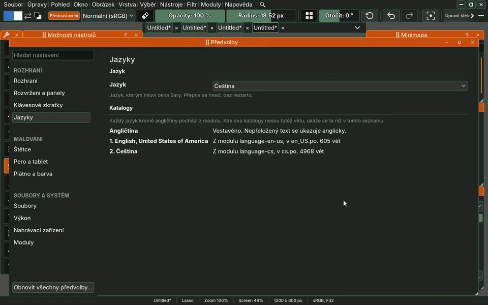

# sara-language-cs, Sara in Czech

This module brings Sara's interface in Czech: menus, dockers, dialogs, tooltips
and the release notes of the welcome window. It holds one catalogue and the
notes and registers them through Sara's door, nothing else.

<p align="center"></p>

## Using Sara in Czech

1. Start Sara with this module on. It ships with Sara and is on by default.
2. Open Preferences, then Languages, and pick Czech in the Language list.
   The change applies at once, with no restart. The first-start window offers
   the same choice among its quick settings.
3. To go back, pick English in the same list.

A text the catalogue has no Czech for shows in English, so a Czech Sara is
never blank.

## The translation is a machine draft

Every message was translated by a machine, from Sara's English template alone,
and a person has checked only part of them. Expect awkward words, wrong
cases and sentences that are too long for their button. Where Krita has a
Czech word for a tool, a blend mode or a docker, the draft takes Krita's, so a
painter who knows Krita in Czech meets the same words.

An entry that nobody has read yet carries the comment
`#. machine draft, not reviewed` in `cs.po`. To count the entries still
unread:

```bash
grep -c 'machine draft, not reviewed' cs.po
```

## Reporting or fixing a wording

A wrong or clumsy Czech text can be reported or fixed in either of two ways.

- **Report it.** Open an issue at
  [github.com/MatejZeman02/sara/issues](https://github.com/MatejZeman02/sara/issues)
  with the English text as Sara shows it under English, the Czech text you
  see, where it appears (the window and the control), and the wording you
  would use.
- **Fix it.** In `cs.po`, find the entry whose `msgid` is the English text,
  correct its `msgstr`, and delete the `#. machine draft, not reviewed` line
  above it, which says a person has now read it. Open a pull request on
  [github.com/MatejZeman02/sara-language-cs](https://github.com/MatejZeman02/sara-language-cs).
  Leave `cs.machine.po` alone, it keeps the draft as it was made so a
  correction can be compared with it.

A plural entry carries Czech's three forms: one, two to four, and five and
over. Names such as Sara, the colour spaces, file formats and the programs
Sara is compared with stay as they are, and Czech declines them where the
grammar asks, so "v Saře" and "Krity" are right.

## What is in the folder

| File | What |
| --- | --- |
| `cs.po` | the catalogue Sara loads |
| `cs.machine.po` | the draft as it was made, every entry flagged `#, fuzzy`, never loaded, kept to compare a correction against |
| `RELEASE-NOTES.md` | Sara's release notes in Czech, shown by the welcome window's News pane while Czech is in force |
| `RELEASE-NOTES.machine.md` | those notes as they were drafted, never read by Sara |
| `module.gd` | registers `cs.po` through Sara's door |
| `CHANGELOG.md` | what changed in this module, in English |

The release notes follow the English `CHANGELOG.md` of Sara's repository
section for section. A section with as many lines as the English one shows in
Czech, and one with more or fewer lines shows in English, so a note added in
English after the draft is never hidden. A section marked
`<!-- machine draft, not reviewed -->` has not been read by a person, and
deleting that line says it has.

## License

GPL-3.0-or-later, as Sara, in `LICENSE`.

## For agents

A language module is a `manifest.cfg`, a `module.gd` and its catalogue, and
this one is the model for the next. A `#, fuzzy` flag cannot mark an unread
entry in `cs.po`, because Godot skips a fuzzy entry when it loads a catalogue
and the page would show English throughout, so the comment line does it.
Krita's Czech is read from its own catalogue, `krita.mo`, with `msgunfmt`.
The project's own gate reads `cs.po` and reports an entry that lost a
protected name, a word that stays in English in every language.
