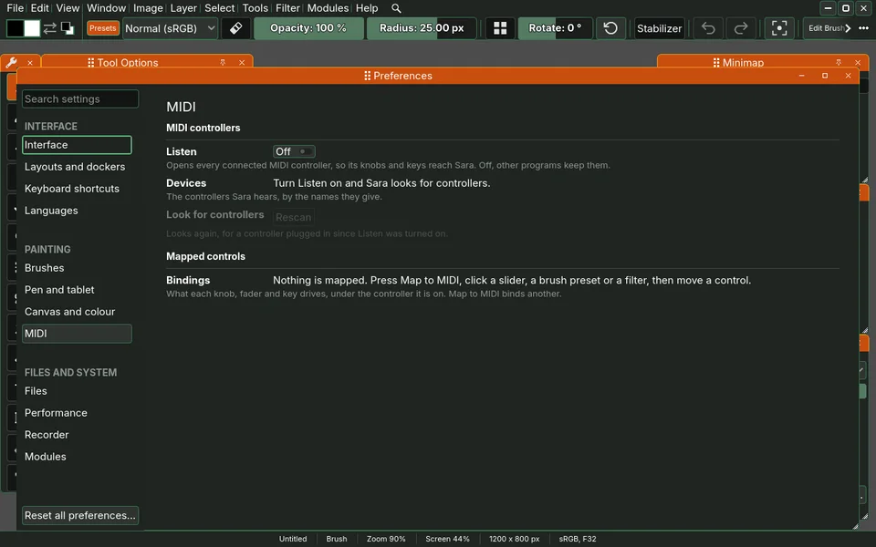

# midi

A Sara module: a MIDI controller's knobs, faders and keys drive Sara.

A knob or a fader turns any slider that names its value, the brush's size, a
filter's option or the active layer's opacity, and a key or a pad chooses a
brush preset or opens a filter. Nothing is bound until the painter binds it.

## Turning it on

1. Open Preferences, then MIDI under Painting, and turn **Listen** on. Sara
   opens every connected controller, and the page lists them by name. Press
   **Rescan** for one plugged in later.
2. Press **Ctrl+Alt+M** (Map to MIDI, rebound on the Keyboard Shortcuts page),
   click a slider, a brush preset or a filter's row, then move the control or
   press the key that should drive it.
3. The MIDI page lists every binding with its Remove, and a Relative switch for
   an endless encoder.

Listen is off by default, because opening the inputs takes a controller from a
music program that may hold it. On Linux Sara reads MIDI through ALSA, so Sara
has to start with sound.

## What it keeps

Listen and the bindings are kept in the painter's `settings.cfg` under
`[module.midi]`. A profile from before the module took them over keeps them
under `[input]`, and the module moves them on its first read.

## How it comes in

`module.gd` registers, through the context Sara hands every module, an input
source, the Preferences page and the Map to MIDI command, and a binding moves
what it drives through `SaContext.drive`. The suites are under `tests/`.

## License

GNU General Public License, version 3 or later. See `LICENSE`.
