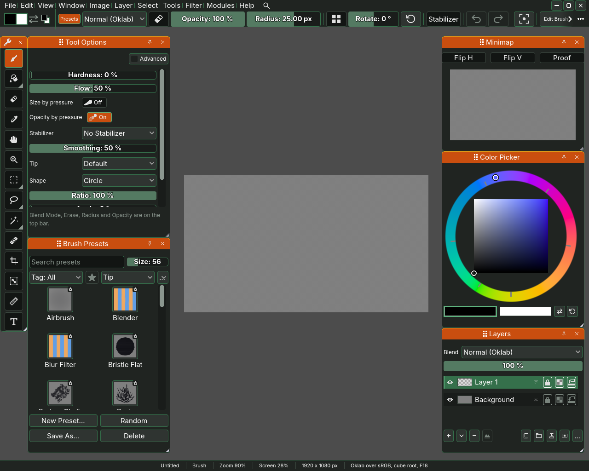
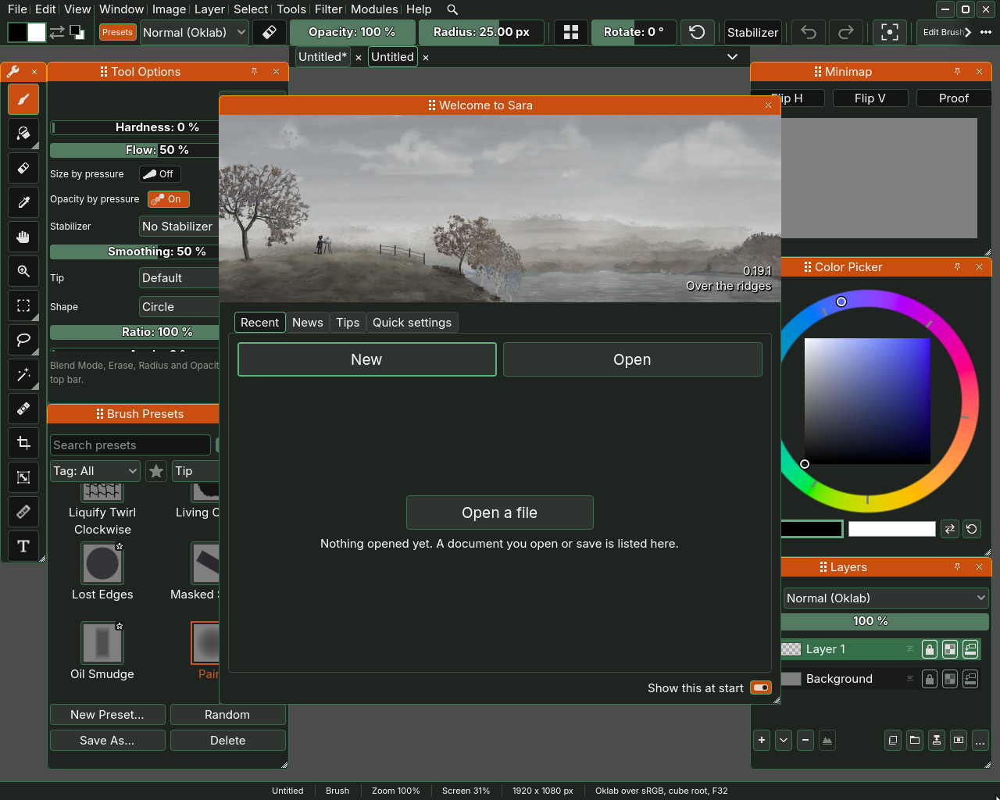

# The window

Sara is one window with the picture in the middle and a row of menus and
options along the top. Small windows of their own, the dockers, sit over the
picture and hold the layers, the colours, the tools and the presets. This page
names each part, so that the rest of the manual can point at it.

Every picture in this manual is a shot of one build, taken in English by the
scenario `scenarios/the-manuals-pictures-show-todays-window.json` at 1280 by
1024, so the pictures agree with each other. A source copy of Sara does not
carry that scenario, because it imports a Krita bundle that only some machines
hold.

## The menus

The top row starts with the menus: **File**, **Edit**, **View**, **Window**,
**Image**, **Layer**, **Select**, **Tools**, **Filter**, **Modules** and
**Help**. A row with keys written beside it answers to those
keys as well, and Help, Keyboard Shortcuts lists every one.

- **File** makes a new picture, opens one, imports a picture as a layer, saves
  and exports. New..., Open File..., Import Picture..., Save, Save As...,
  Export... and Quit are its rows.
- **Edit** holds Undo, Redo, Cut, Copy, Paste and Preferences...
- **View** changes how you look at the picture and never the picture itself:
  Zoom In, Zoom Out, Reset Zoom, Actual Pixels, Fit to View, Fit to Window,
  Centre View, Rotate Left, Rotate Right, Reset Rotation, Flip View
  Horizontally, the grid, and the checks that show lightness, false colour and
  colours outside the gamut.
- **Window** has one row per docker, which opens it or closes it, the layouts
  the dockers can be arranged in, and Fullscreen.
- **Image** resizes the image or its canvas, crops to the selection and changes
  the colour space.
- **Layer** and **Select** work on layers and on selections.
- **Tools** picks a tool, the same way the toolbox does.
- **Filter** applies a filter. Browse Filters... calls up the Filters docker,
  which lists every filter, as [the filters page](07-filters.md) shows.
- **Modules** lists the modules Sara has loaded, which is where its tools and
  filters come from. Its last section, Develop, is for writing a module: the
  developers' documentation on the web, New Module..., the folder your own
  modules go in, Reload Modules, Reload Shaders, Copy the kernel prompt and
  Local Server. Ticking Local Server opens a server on this computer only,
  which a notebook or a coding agent such as Claude paints this Sara through.
  Its window says where the server is and how a notebook connects, and its
  button copies a first message for an agent, which you paste into its
  conversation. Untick it to close the server.
- **Help** has the welcome window, this manual, Report a Problem, Take a Note,
  Display Settings..., Tablet Settings... and Keyboard Shortcuts, which open
  Preferences at the display colour profile, the tablet calibration and the
  keyboard shortcuts, and About Sara.

## The top bar

The top bar has two rows, as Krita's does. The first holds the menus. The
second starts with the colours you paint with and carries the options of the
tool in your hand, and they change when the tool does. With the brush they are
the brush preset, the blend mode, Keep Blend Mode, the eraser switch, the size
and the opacity, then **Flat**, which reads **Environment** while you look at a
panorama from inside and is greyed on a flat picture until Image,
Projection... makes it a panorama, then the Rotate slider that turns the
view and its reset button, Mirror H and Mirror V, the two buttons with an axis
between a shape and its reflection, and Radial, which repeat every stroke
across an axis or around the centre, Stabilizer, which steadies the stroke, and
Edit Brush, which opens the brush editor. Options that do not fit go into a
list the three dots at the end of the row open: at 1280 pixels wide, as in the
picture above, Keep Blend Mode and Mirror H are in it. View, Show Second Row
takes the second row away and puts the options on the first row after the
menus.

The symmetry axes are drawn over the picture in orange, with two round handles
on the line. With a brush, the eraser, the fill, the gradient or the eyedropper
in hand, the pointer turns into a move cursor over a handle or the line, and a
drag there moves the axes rather than painting. Drag a handle to turn and
stretch the axis about the other handle, so it can stand at any angle, and hold
Shift to turn it in steps of 15 degrees. Drag the line away from its handles to
move the whole axis without turning it. With Radial alone one handle is the
centre, which moves the spokes, and the other is the end of the first spoke,
which turns them. A mirror and Radial on together share one centre and one
angle, and the second mirror stays at right angles to the first. Double-click a
handle or the line to put the axes back upright in the middle. The axes and the
three switches are saved with the document.

At the right end are the buttons that minimize, maximize and close the window.
View, Show Window Buttons hides them, for a painter whose system draws its own.

## The dockers

A docker is a small window that floats over the picture. Sara opens with five:
**Toolbox**, **Brush Presets**, **Tool Options**, **Colour Picker** and
**Layers**. Drag a docker by its title strip to move it, or hold Alt and
drag anywhere on it. Drag its edge to resize it, or hold Alt and drag with the
right button. The Window menu opens the others: Info, Recorder, Minimap, Graph,
Recent Presets, Undo History, Reference and Pop-up Palette.

- **Toolbox** holds the tools, grouped so that one button stands for a few
  tools of a kind. Its buttons say which tool they are, with the key that picks
  it, when you hold the pointer over them: Brush (B), Eyedropper (I), Pan (Q),
  Marquee (M) and Crop (C).
- **Tool Options** has the options of the tool in hand that the top bar does
  not carry. It says which ones the bar has, such as the blend mode, the eraser
  switch, the radius and the opacity.
- **Layers** lists the layers of the picture.
- **Colour Picker** chooses the colour you paint with.
- **Brush Presets** holds the brushes, ready to pick.

**Reference**, one of the others, holds pictures to paint from, beside the one
you paint on. A painter coming from Krita looks for it in the toolbox, where
Krita keeps its reference images, and it is not there: every button of Sara's
toolbox is a tool, and the reference board is a docker. Window, Reference opens
it, and so does Shift+F with Sara's own shortcuts. Its Open... button adds a
picture from a file, and a picture dropped on it from a file manager or pasted
into it with Edit, Paste lands on the board as well. On the board, a drag on a
picture moves it, a drag on the empty board draws a box that selects every
picture it touches, Ctrl or Shift with a click adds a picture to the
selection or takes it out, and the middle button or Shift with a drag moves
the board. A drag on one of the selected pictures moves them all, and Delete
takes them off the board. With the pointer on the board, the ways the canvas
zooms zoom the board instead: the wheel, Ctrl+Space held with a drag right
or up to come closer and left or down to go back, Ctrl and the equals or
minus key, and a pinch, so a pen with no wheel zooms it too.

The Window menu keeps the layouts the dockers can be arranged in, default,
minimalistic, useful and full, and remembers where you put each docker.

## The canvas

The picture sits on the canvas, the space the dockers float over. The View
menu zooms, turns and flips the view, and the Pan tool, Q, moves it. Turning
or flipping the view changes how the picture looks to you and nothing about
the picture, which is why they are under View and not under Image. Along the
bottom edge, the status line says the name of the picture in front as its
tab reads it, a star while it has unsaved changes, and the tool in your hand,
a tool held on a key included while you hold it. Then come the zoom, the
picture's size in pixels and its colour space, and Fit to View leaves the
picture room above it. A name too long for the line is cut short with an
ellipsis, the picture's before the tool's, and rest the pointer on it to read
it whole. Fit to
View and Centre View put the picture between the dockers, and Fit to Window
spreads it across the whole window, under the dockers as well.

The zoom is two figures. **Zoom** is how big the picture is on screen: 100
percent is the whole picture fitted between the bars and the dockers, which is
what Fit to View shows, 200 percent is twice that and 50 percent half, whatever
the picture's size in pixels. It is measured against that room, so opening or
closing a docker column moves the figure while the picture stays where it is.
**Screen** is one pixel of the picture against the pixels of your screen: at
100 percent each pixel of the picture is one pixel of the screen, which is what
Actual Pixels shows, at any interface scale. Reset Zoom, Ctrl+0, shows what
**Reset zoom to** in Preferences > Canvas and colour says, and a new or opened
picture opens that way. Reset Zoom, Actual Pixels and Fit to View centre the
picture between the bars and the dockers, and the zoom and turn keys keep that
middle where it is.

## The welcome window

When Sara starts with no picture, it opens the welcome window, **Welcome to
Sara**, under a painting made in Sara, with the version in its corner. It
offers **New** and **Open**, the pictures you had open lately under
**Recent**, what changed in this version under **News**, one tip at a time
on what Sara does that other programs do not under **Tips**, and **Quick
settings**: the UI scale, the colour theme, the pen pressure and whether the
dockers live inside the main window. Above them, **I'm coming from** has a
button each for Krita, Photoshop, Procreate and Clip Studio Paint, and one
press sets the shortcuts, the colour theme, the docker layout, the colour
picker's shape and what Ctrl+0 shows to that program's, leaving the UI scale
as it is, so the keys and the windows feel like home. A press asks first: it
names the program and lists each of those settings as it is now and as it
will be, and nothing changes until you press **Overwrite**. **Cancel**, the
default, and Escape leave everything as it was, and where your settings are
already the program's it asks nothing. Your own shortcut profiles, palettes
and layouts stay on disk either way, ready to pick again. Press the lit
button again, and answer the same question, and Sara's own settings come
back, with no button lit. If you have used no painting program, leave the
row as it is. Switch off **Show this at start** and it stays
away. Help, Welcome brings it back whenever you want it.

