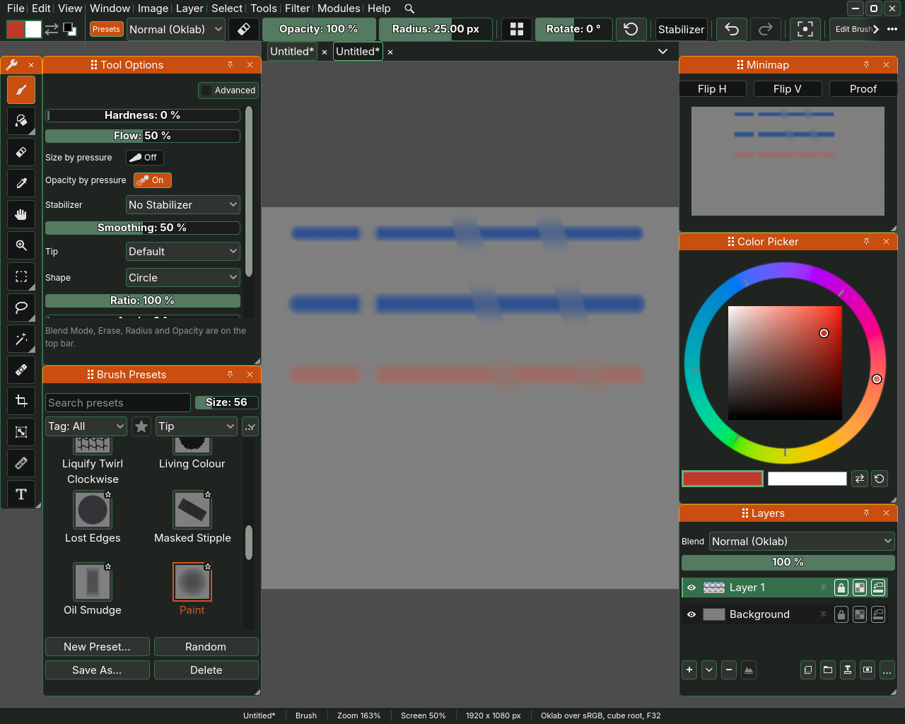
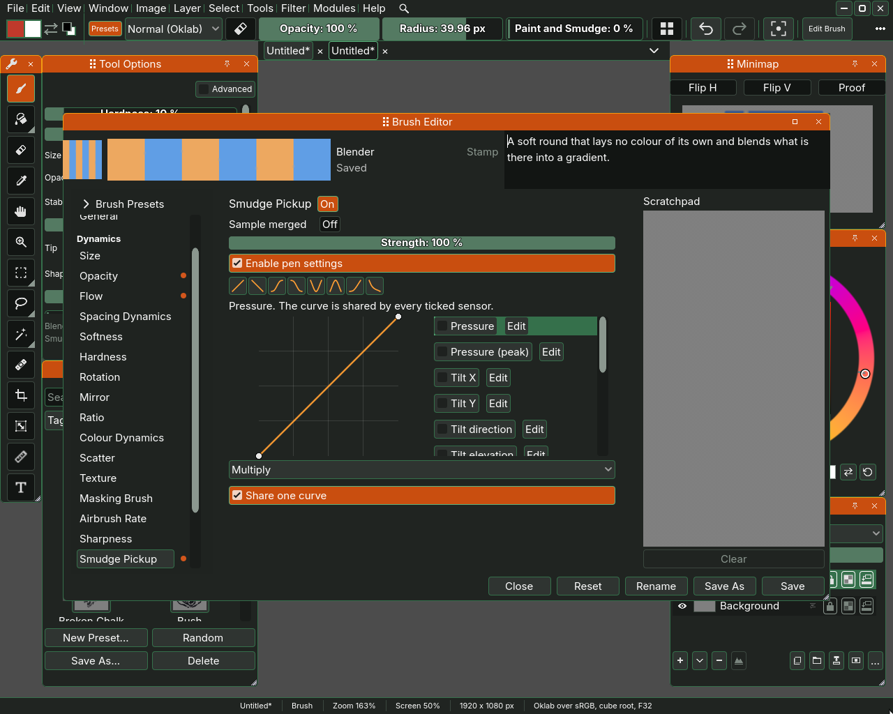

# Painting

Painting in Sara is the brush. Pick it in the toolbox, whose tip reads
**Brush (B)**, or press B, and drag across the picture. The brush paints with
the foreground colour, the top square of the pair described on
[the colour page](04-colour.md). This page covers how big and how strong a
stroke is, how to erase, and how to smudge paint that is already down.

## Where the brush's options live

The options of the brush are in two places, and both change the same brush.

- The **top bar**, on its second row, shows the preset, the blend mode, Keep
  Blend Mode, the eraser switch, the size and the opacity, as
  [the window page](01-the-window.md) describes. When the window is too narrow
  for them all, the ones that do not fit go into a list that the three dots at
  the end of the bar open. At 1280 pixels wide, with Paint, the preset Sara
  starts with, Keep Blend Mode and Mirror H are in that list, and Blender's
  wider size sends Mirror V and Radial there as well. Overflow, behind
  **Customize...** on the Top bar line of Preferences, Layouts and dockers,
  turns the list off, and the row scrolls instead.
- The **Tool Options** docker lists the rest as rows with a slider or a box
  each. With Paint they are Hardness, Flow, Size by pressure, Opacity by
  pressure, Stabilizer and Smoothing, then Tip, Shape, Ratio, Spacing and
  Cross. A
  line at the foot of the docker names the options that are on the bar
  instead, Blend Mode, Erase, Radius and Opacity while they all fit there, and
  an option the bar has no room for comes back as a row. Tick **Advanced** at
  the top of the docker for every other setting the brush has.

Rest the pointer on any row and its tip says what the row does.

## Size

**Radius** is how far the brush reaches from its centre, in pixels of the
picture, so a stroke is twice as wide as the number. The brush Sara starts
with is 25 px. Press ] to make the brush bigger and [ to make it smaller.
Each press changes the size by a step that grows with the brush, so three
presses of ] take 25 px to about 33 px.

You can also drag the Radius slider. Hold Shift while you drag and it moves
at a tenth of the speed, from where it stands. With the pointer resting on
the slider, Left and Right change it by a pixel, and by ten with Shift.
Double-click it to type a number. The same keys work on the other sliders,
a per cent at a time on Opacity.

**Size by pressure** makes a pen that presses harder draw a wider line. It is
off on the brush Sara starts with.

## Straight lines

To paint a straight line, paint a stroke or click once where the line starts,
then hold Shift and click where it ends. The line runs from where the last
stroke let go to the click. Keep Shift held and click again, and the next
segment goes on from the end of the one before, so a few clicks draw a
zigzag or an outline. Shift with a drag sizes the brush instead, so keep the
pen or mouse still while you click. Hold Ctrl as well as Shift and the line
turns to the nearest step of 15 degrees at the same length, so a level
horizon or an exact 45 degrees needs no aim. Under the Krita shortcut profile a held Ctrl is the quick
colour pick, so there a Ctrl Shift click picks a colour and the line does not
snap. On a layer with no stroke yet, a
Shift click paints nothing and the status line says why.

## Opacity and flow

**Opacity** is how much a stroke covers what is under it. At 100 % the colour
hides the picture below, at 40 % the picture shows through, as the red stroke
in the picture above does over the blue one. **Opacity by pressure** is on at
the start, so a light touch paints fainter than a firm one.

**Flow** is how much paint each dab of the brush lays down. A stroke is a row
of dabs, and **Spacing** is how far apart they are, as a share of the tip's
size. With Flow under 100 % the dabs build up where they overlap, so a stroke
darkens slowly towards its opacity.

**Cross** chooses what happens where a stroke runs over itself. Build-up
darkens the crossing. Wash reaches the opacity it was set to and stops.

**Hardness** is how sharp the edge of the tip is. At 0 % the edge fades out,
and higher values give a crisper edge.

## Erasing

The eraser is the brush turned round, it takes paint away from the active
layer instead of adding it. There are three ways to it.

- Press E, which switches the brush between painting and erasing. Press E
  again to paint. The eraser switch on the top bar follows the key, and so
  does the Erase row in the Tool Options docker when the bar has no room for
  the switch.
- Press the eraser switch on the top bar, or tick **Erase** in the Tool
  Options docker where the row is.
- Load one of the presets **Eraser** or **Soft Eraser**, which are brushes set
  up to erase.

The size, opacity and every other option work the same while erasing, so a
low opacity rubs paint out gently.

## Smudging

A smudging brush picks up the paint under it and drags it along the stroke,
the way a finger drags wet paint. The presets **Blender** and **Oil Smudge**
smudge. Load one, as [the presets page](03-brush-presets.md) describes, and
drag across paint that is already down. The two lines on the right of the
picture at the top were painted with Blender across the strokes beside them.

To make any brush smudge, open the brush editor with **Edit Brush**, whose tip
reads "Open the brush editor at the page you were last on", press **Smudge
Pickup** under **Dynamics** in its list of pages, and turn on the switch
beside the page's title. A dot beside a page's name in the list says it is on.
The page holds a curve, which says how much paint the brush picks up for each
amount of pressure, tilt, speed or the other inputs it lists. **Colour Rate**
says how much of the brush's own colour each dab lays beside the paint it
drags, from 0, a pure smudge, to 1, the brush's colour alone. It starts ticked
at a half, so a brush you have just made smudge paints and smudges at once,
and unticked it reads 0. **Smear Length** says how far the drag lasts. Both
do nothing while Smudge Pickup is off, and Opacity still scales what the dab
lays.

The line under the brush's name at the top of the editor reads **Saved** while
the brush is the preset as it was stored, and **Unsaved changes** once you
have changed something. Painting is not a change to the brush, so a stroke
leaves it reading Saved. [The presets page](03-brush-presets.md) says how to
keep a changed brush as a preset of its own.

Every stroke can be undone with Edit, Undo. [The window](01-the-window.md)
names the dockers and menus this page refers to.
