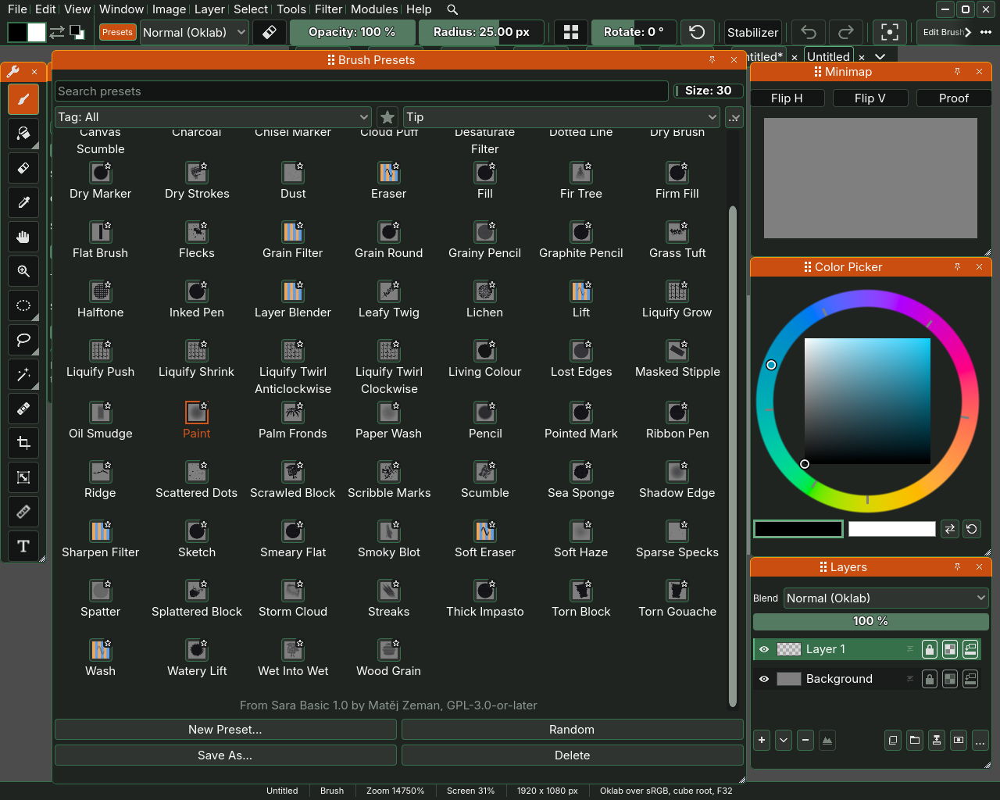
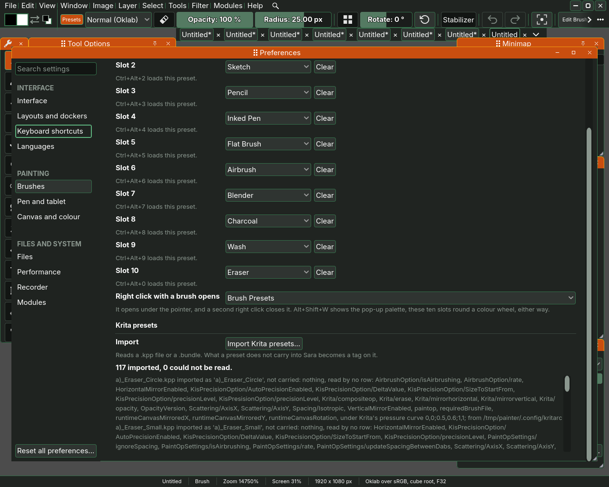
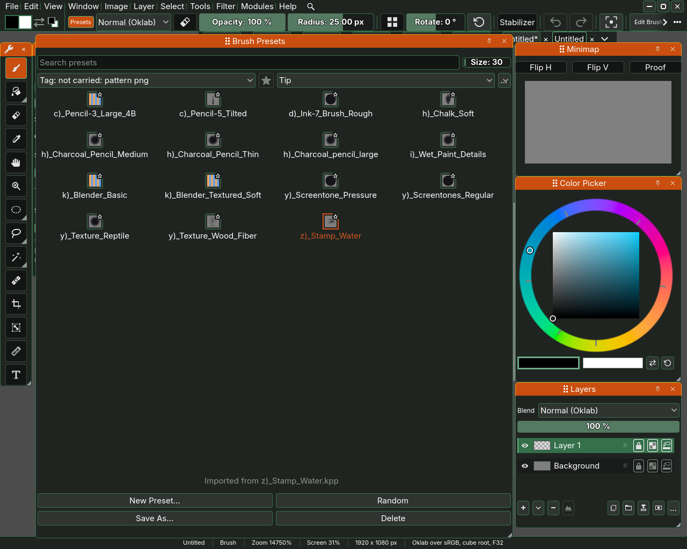

# Brush presets

A preset is a brush with all its settings stored under a name, so that one
click gives you a pencil, an ink pen or a smudging blender. Sara comes with 63
presets and reads the presets Krita writes as well, because Sara's stamp brush
follows the design of Krita's pixel brush engine. This page shows how to
find a preset, keep your own, sort presets with tags, and bring presets over
from Krita.

## The Brush Presets docker

Open the docker with Window, Brush Presets, or press the button with the
preset's name, **Paint** at first, after the colours at the start of the top
bar's second row. The button stays lit while the docker is open. The docker
shows a grid of cells, one per preset, and the line under the grid names the
preset under the pointer.

Click a cell to load its preset. The brush takes every setting the preset
stored, and the top bar and the Tool Options docker show them. The presets
Sara comes with are Airbrush, Blender, Blur Filter, Bristle Flat, Broken
Chalk, Bush, Canvas Brush, Canvas Scumble, Charcoal, Chisel Marker, Cloud
Puff, Desaturate Filter, Dotted Line, Dry Brush, Dry Marker, Dry Strokes,
Dust, Eraser, Fill, Fir Tree, Flat Brush, Flecks, Grain Filter, Grain Round,
Grainy Pencil, Grass Tuft, Halftone, Inked Pen, Layer Blender, Leafy Twig,
Lichen, Lift, Living Colour, Lost Edges, Masked Stipple, Oil Smudge, Paint,
Palm Fronds, Paper Wash, Pencil, Pointed Mark, Ridge, Scattered Dots, Scrawled
Block, Scribble Marks, Scumble, Shadow Edge, Sharpen Filter, Sketch, Smoky
Blot, Soft Eraser, Soft Haze, Sparse Specks, Spatter, Splattered Block, Storm
Cloud, Streaks, Thick Impasto, Torn Block, Wash, Watery Lift, Wet Into Wet and
Wood Grain. A cell whose preset is written for another engine than the brush in hand
names that engine under the preset's name, such as Noise or Filter.

Along the top of the docker are three ways to narrow the grid down.

- The **Search presets** field keeps the presets whose name holds what you
  type. Typing pen leaves Grainy Pencil, Inked Pen and Pencil.
- The tag list, which reads **Tag: All** at first, keeps only the presets with the
  tag you choose. Its rows are the tags by name, and the one you choose stays
  chosen when you pick a preset, save one, star one or change tool, until you
  choose All again or no preset carries the tag any more. Renaming the tag
  moves the choice to its new name.
- The last list chooses what a cell shows: **Strokes**, a short stroke painted
  with the brush, or **Tip**, the shape of its tip.

## Keeping a brush as a preset

Change the brush as you like, in the top bar, the Tool Options docker or the
brush editor. The line under the brush's name in the brush editor then reads
**Unsaved changes**.
Press **Save As...** in the docker, type a name in the field that opens and
press Enter. The new preset appears in the grid. Press Escape instead to leave
without saving.

**New Preset...** puts the brush's default settings in front of you, with no
preset loaded, as a clean start for a brush of your own. **Delete** removes
the selected preset, and asks first, because a deleted preset cannot be
brought back.

## Tags

A tag is a word a preset carries, and a preset can carry many. The presets
Sara comes with are tagged already. Blender, for example, carries smudge and
soft.

Press a cell with the right mouse button for its tag menu. Each tag there has
a tick, and clicking one puts the tag on the preset or takes it off.
**New tag...** makes a tag and puts it on the preset. Once a tag is chosen in
the docker's tag list, the same list offers **Rename tag...** and
**Delete tag...** for it.

## Importing presets from Krita

Sara reads a single Krita preset, a .kpp file, and a Krita bundle, a .bundle
file that holds many presets and the tips and papers they use. Open Edit,
Preferences..., go to the **Brushes** page and press
**Import Krita presets...** under **Krita presets**. Choose the file, and the
page says how many presets came in and how many it could not read, with a
line for each preset below.

Each imported preset joins the grid with the tag **imported**, and the line
under the grid reads Imported from and the name of the file it came from.

Importing the same file again leaves the presets you already have alone. The
count then says how many were already in your presets, and a
**Replace them** button beside it imports those again, with their settings and
the import's tags written afresh. Tags you put on a preset yourself stay, and a
preset you saved under a new name is never touched. Use it when Sara has
learnt to carry more of a Krita preset than it did the first time, and the
not-carried tags below get fewer.

## What the not-carried tags mean

A Krita preset can hold settings Sara has no brush for. Rather than drop them
without a word, the import puts a tag on the preset for each one, and every
such tag starts with **not carried:**. Choose one in the tag list to see which
presets it touches. A preset with a not-carried tag still paints, it paints
without the part the tag names.

These are the tags the import writes, as they read today. A tag that ends in
a name, such as blend mode copy, names what was lost.

The paper and the tip:

- **not carried: pattern png** and **not carried: pattern pat** mean the
  preset painted through a paper texture, a picture in PNG or in Krita's PAT
  format, which did not come with the preset. The brush paints without the
  paper.
- **not carried: texturing mode** means the paper was applied in a way Sara
  does not have, and Sara multiplies the paper into the stroke instead.
- **not carried: image tip** means the tip is a picture that could not be
  kept, and **not carried: tip:** and a file name means the tip is a picture
  Sara does not read. That tag says so and names the kinds it does read, a
  .png or a .gbr.
- **not carried: pipe tip:** and a file name means an animated tip, one that
  steps through several pictures, which Sara read only part of. The tag says
  where it stopped. **not carried: pipe selection mode** and a name mean a way
  of choosing the tip's next picture that Sara does not have.
- **not carried: mask softness curve, it does not descend** means the curve
  that softens the tip's edge climbs somewhere on its way to the rim. Such a
  tip would paint a ring with a hole in it, so the tip keeps Sara's own soft
  edge instead.

How the paint goes down:

- **not carried: blend mode** and a name, such as copy or color, means the
  preset used a blend mode Sara does not have. The brush keeps the blend mode
  a new brush starts with.
- **not carried: painting mode** means a way of laying down paint other than
  Build-up and Wash, the two choices of the Cross row.
- **not carried: colour source** and **not carried: colour gradient** mean the
  preset took its colour from somewhere other than the foreground, which Sara
  does not do. The brush paints with the foreground.

The masking brush, a second tip that masks the first:

- **not carried: masking brush** means the preset had one but Sara could not
  read how it was made, so the brush paints without it.
- **not carried: masking tip** means the mask's tip could not be read, and the
  brush paints without the mask.
- **not carried: masking composite op** and a name mean the mask was mixed
  with the tip in a way Sara does not have. Sara multiplies the two instead.
- **not carried: masking size in pixels** means Krita held the mask at a fixed
  size. It looks right when the preset lands, but in Sara the mask grows and
  shrinks with the Size row.
- **not carried: masking dynamics:** and a name mean the mask changed with
  pressure or another input in a way Sara leaves out.

Delete a not-carried tag from the tag list once you have looked at it, if you
do not need the reminder. The presets keep working the same.

Back to [painting](02-painting.md) or on to [colour](04-colour.md).
