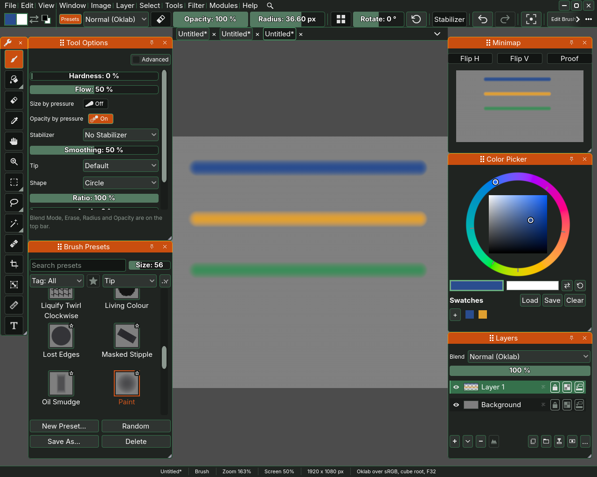
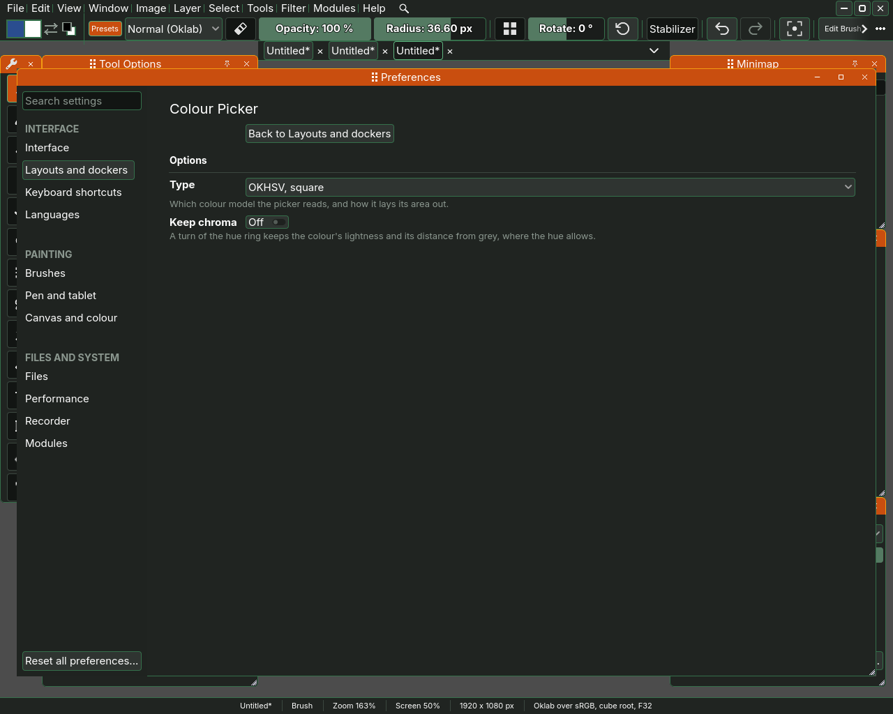

# Colour

The brush paints with the foreground colour. This page shows how to choose it
in the Colour Picker docker, how to keep colours as swatches, and how to take
a colour off the picture with the eyedropper.

## Foreground and background

Sara keeps two colours at once, a foreground over a background. The pair is
drawn as two squares, one over the other, at the start of the second row of
the top bar, and as two bars side by side in the Colour Picker docker.

- The front square, the left bar in the docker, is the **foreground**, what
  the brush paints with.
- The back square, the right bar, is the **background**.
- Press X, or click the arrow or the back square, to swap the two.
- Press D, or the ↺ button in the docker, to reset them to black over white.

## The Colour Picker docker

Open it with Window, Colour Picker. It can hold the parts below, and the
default layout shows the colour area and the pair. **Customize...**, under
Changing the picker below, switches the others on and sets their order, which
is how the row of swatches came to be in the picture at the top of this page.

- The colour area, a wheel or a square depending on the type chosen in
  Preferences. Click or drag in it to choose the foreground.
- **Hex:**, a field with the foreground's colour as a hex code such as
  2a4d8f. Type a code and press Enter to set the colour exactly.
- The foreground and background pair and ↺, as above.
- The row of swatches, the colours you keep, with the buttons + Load, Save
  and Clear.
- The row of recent colours, the colours used lately, newest first. A colour
  lands here when you finish choosing it in the colour area, the sliders or
  the hex field. For now a colour the eyedropper picks does not land here.
- Sliders **R**, **G** and **B** for red, green and blue, and **H**, **S** and
  **V** for hue, saturation and value in OKHSV, a model where equal steps look
  like equal changes to the eye.

## Swatches

A swatch is a colour kept for later. The swatches, the pair and the recent
colours come back when Sara starts again.

- **+** keeps the foreground colour as a swatch.
- Click a swatch to make it the foreground. Press it with the right mouse
  button and Sara asks whether to remove it.
- **Load** reads a GIMP palette, a .gpl file. It asks whether to replace the
  kept swatches or to add the palette's colours after them.
- **Save** writes the kept swatches to a GIMP palette file, which GIMP, Krita
  and Inkscape read as well.
- **Clear** throws away every kept swatch.

## The eyedropper

The eyedropper takes a colour off the picture and makes it the foreground.
Pick it in the toolbox, whose tip reads **Eyedropper (I)**, or press I, and
click the colour you want. In the picture at the top of this page the
eyedropper picked the blue of the top stroke back up, and the front square of
the pair shows it.

Hold Alt while the brush is in hand to use the eyedropper for a moment, and let
go to paint again.

With the eyedropper in hand, the Tool Options docker shows two rows.

- **Sample**, the slider, is the side of the square of pixels averaged around
  the pointer, from 1 to 25 in steps of two so the pixel under the pointer is
  always its centre. A larger size picks the average colour of a noisy patch
  rather than one grain, and Sara remembers it the next time it opens.
- **Sample**, the choice beside it, says what a click picks. **View**, the first choice, picks the
  colour the picture shows, every filter on a layer or a group applied.
  **Layer** picks the active layer as it was painted, before its filters and
  the layers above it. Sara remembers the choice the next time it opens. The
  highlight tone map, proofing and False Colour change how the screen shows a
  colour rather than the colour, so View picks the colour under them.

## Changing the picker

Hold Alt and double click anywhere on the Colour Picker docker to open
Preferences on its line of **Layouts and dockers**. **Customize...** on the
line chooses which parts of the docker are shown, and their order, and
**Options...** holds the picker's own settings.

- **Type** chooses the colour model the picker reads and how its area is laid
  out: OKHSV, square, OK-HSL, disc, OKLCh, triangle, OKLCh, triangle with
  saturation up, HSV, square, HSV, triangle, and HSL, square.
- **Keep chroma** makes a turn of the hue ring keep the colour's lightness
  and its distance from grey, where the hue allows. It is off at first.

The buttons on its drag bar, and what a summoned docker does, are the same
for every docker, so they are set once at the top of the same page, under
**Every docker** and **Summoned dockers**, on
[Shortcuts and preferences](10-shortcuts-and-preferences.md).

[Painting](02-painting.md) and [brush presets](03-brush-presets.md) cover the
brush that paints with these colours.
