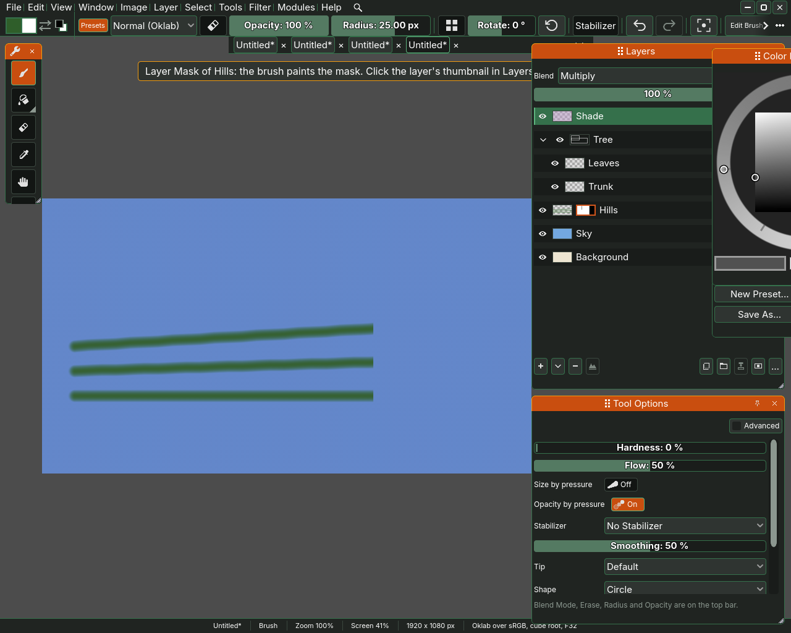
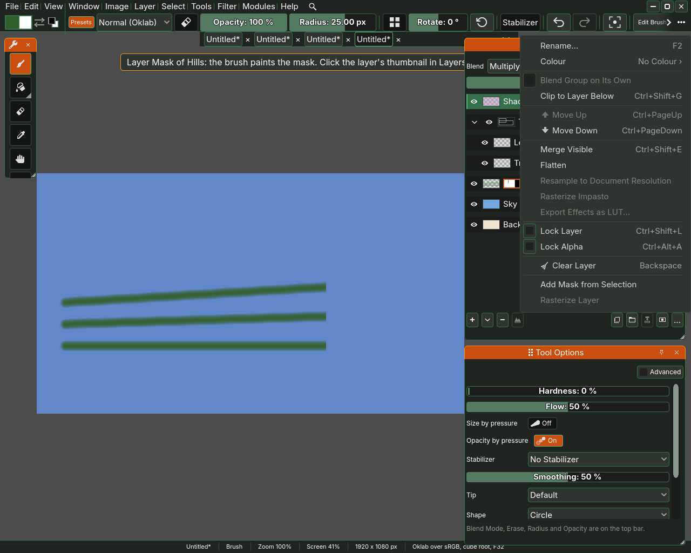
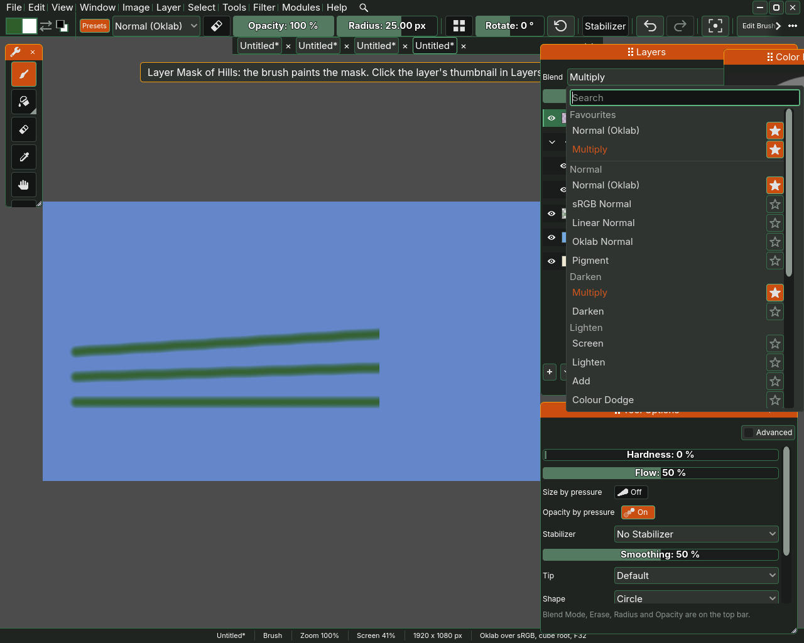

# Layers

A picture in Sara is a stack of layers, each a sheet you paint on without
touching the others. The Layers docker shows the stack with the top layer
first, and everything on this page happens there or in the **Layer** menu. The
layer with the highlighted row is the active one, and the brush, the filters
and the transform tool all work on it.

## The rows

Each row shows a small picture of the layer, its name and a set of switches.
Press a row to make it the active layer. Hold Ctrl and press another row to
pick both, which is how several layers go into one group.

- The eye shows or hides the layer, and is shut while the layer is hidden.
- The note mark after the name is lit when the layer carries a note, and
  resting the pointer on the row shows the note. Press it to make the layer
  the active one and open the note in **Rename Layer**. A dimmed mark, **Add a
  note to this layer**, opens the same window to write one.
- The lock, **Lock painting on this layer**, stops the brush on that layer.
  A stroke on a locked layer paints nothing, and Sara says so: This layer is
  locked, so the stroke did nothing. Unlock it in the Layers docker.
- The alpha lock, **Paint only where this layer already has paint**, keeps
  every stroke inside what is already painted. Turned on from the Layer menu
  or its key, it says so in the corner, with the key that turns it off.
- The clip, **Clip this layer to the one below**, shows the layer only where
  the layer under it has paint.
- A group has a fold mark, **Collapse this group** or **Expand this group**,
  that hides or shows the layers inside it.

Press F2 in the Layers docker to rename the active layer in its row, type the
name and press Enter. Over the canvas F2 opens **Rename Layer**, the window the
Layer menu's **Rename...** opens, with the name ready to type over. A double
click on a name renames that layer in its row as well.

## The buttons under the list

- The plus, **+**, is **Add a paint layer** and adds an empty layer.
- **▾**, **Add another kind of layer**, offers **Paint Layer**, **Paper**,
  **Canvas**, **Adjustment Layer** and **Effect Layer**. Paper is a ground of
  off-white grain to put under a painting. It is a layer to look at, and the
  brush neither paints on it nor reads it. A Paper or a Canvas arrives named
  for its kind, Paper 2 for a second, over the Background and under every
  painted layer, and its row shows its two colours and no paint or alpha
  lock, since it holds no paint. Rest the pointer on a row and it
  says what that kind of layer does. **Adjustment Layer** and **Effect Layer**
  hold a filter rather than paint, so each opens the list of filters first:
  pick one and press **Add Layer**, and the layer arrives named for the filter
  with the filter's settings open on it. **Cancel** there takes the layer away
  again. An adjustment layer runs its filter
  over every layer below it, and its list leaves off the filters that read a
  whole layer at once, such as Wrap Offset. An effect layer shows the layer
  that was active through its filter. The Layer menu's rows of the same names
  do the same. A group is made with the group button beside them, or Group in
  the More menu or the Layer menu.
- The minus, **-**, deletes the active layer. On the only layer it empties
  the layer instead of taking it out.
- **…** opens the More menu.

Above them, on one row, the blend list on the left, after the word **Layer**,
says how the layer mixes with the ones below it, and the opacity slider on the
right says how much of it shows, in per cent. The word is there because the
bar shows the brush's blend mode in the same words. Each can be hidden on its own from the docker's element
list in Preferences, and the other then takes the whole row.

## The More menu

The More menu holds everything else a layer can do, under the names and in the
order the Layer menu gives them: **Rename...**, **Duplicate Layer**, **Group**,
**Blend Group on Its Own**, **Clip to Layer Below**, **Move Up**, **Move
Down**, **Merge Down**, **Flatten**, **Resample to Document Resolution**, **Lock
Layer**, **Lock Alpha** and **Clear Layer**, and below them the mask rows. A
row that has a button under the list stands there and leaves the menu, until
the docker is too narrow for the button. A row that cannot act is dimmed and
takes no press, such as Move Up on the top layer and Blend Group on Its Own on
anything but a group. On a group, the rows that act on a layer's own pixels,
Merge Down, Resample, the two locks and Clear Layer, are dimmed and say why.

Rename... opens the **Rename Layer** window, with a **Name** and a **Note** for
the layer, then **Cancel** and **Rename**. The note is yours, for whatever you
want to remember about the layer. The window is only as tall as it needs to be:
the note is one line until it holds text or you click it, and then it grows with
what you write, to five lines at most.

Group puts the picked layers into a new group. With a group active the row
reads **Ungroup** and takes the layers back out of it. A group has its own eye, blend and
opacity, which act on everything inside it at once. Blend Group on Its Own
mixes the group's layers with each other before the group meets the layers
below it.

## Masks

A mask hides part of a layer without erasing it. **Add Mask** gives the active
layer a mask that shows all of it, and the mask appears as a second small
picture in the row. Press that picture to pick the mask, and the brush then
paints on the mask: dark hides the layer and light shows it again. Press the
layer's own picture to go back to painting the layer.

With a mask on the layer, the mask rows of the More menu come alive. **Delete
Mask** takes it off, **Apply Mask** writes it into the layer and takes it off,
**Invert Mask** swaps what shows and what hides, **Disable Mask** switches it
off for a while and **Mask to Selection** turns it into a selection. **Add Mask
from Selection** makes a mask out of the selection instead of an empty one.

## Colourise layers

A Colourise layer fills the closed shapes of a line art layer with the colours
you scribble inside them. Add one from Layer > Other Layers > Colourise Line Art,
scribble a colour inside each shape, then press **Update**, or leave **Auto
update** on to fill after every stroke. **Line art** names the layer whose lines
bound the shapes, the nearest one below by default. Colours run under the lines
to their middle, and a shape with no scribble stays empty.

**Gap closing** holds the colour in across breaks up to that many pixels across,
measured in document pixels rather than on the screen, and a large value paints
a band of colour outside every line. A scribble that crosses a line joins the
two sides, so the colour runs out of the shape. A scribble in the **Transparent
key** colour, magenta to start with, marks a shape to leave empty and is not
painted, so only **Show scribbles alone** shows it. Ctrl+Z takes a scribble back
and the fill follows. **Convert to Paint Layer** writes the colours out as an
ordinary paint layer.

## Blend modes

The blend list is grouped under **Favourites**, **Normal**, **Darken**,
**Lighten**, **Contrast**, **Comparative** and **Colour**. A new layer starts on
**Normal (Oklab)**, which mixes colours the way the eye sees them change.
The mode in use is drawn in the accent colour. The star at the end of each row
puts that mode under Favourites or takes it off, and Favourites starts with
Normal (Oklab) and Multiply. Hold the pointer over a row to read what the mode
does. A **Search** field at the top of the list keeps the modes whose name
holds what you type, each under its heading.
Plain Normal mixes in whatever the document stores, which the brackets name,
so on an Oklab document it reads Normal (Oklab). **Oklab Normal** mixes in
Oklab on every document, **sRGB Normal** mixes the numbers as other programs
mostly do, and **Linear Normal** mixes in linear light.

**Multiply** and **Darken** only ever darken, **Screen**, **Lighten**, **Add**
and **Colour Dodge** only ever lighten, and **Overlay**, **Soft Light**, **Hard
Light** and **Hard Mix** raise the contrast. **Divide**, beside Colour Dodge,
divides what is below by the layer's colour, so white changes nothing and a
darker colour lightens it, past white where it is dark enough, while a colour
above white darkens it. **Difference** and **Exclusion**
compare the layer with what is below it. **Hue**, **Saturation**, **Colour** and
**Lightness** take that one quality from the layer and the rest from below.

The same list on the top bar is the brush's blend, and it mixes each stroke
with the paint already on the layer it lands on, not with the layers below. A
Multiply stroke over paint on its own layer darkens that paint, and a Multiply
stroke on an empty layer lays its own colour, as Normal would, because there
is nothing on that layer to multiply. To multiply with the layers below, set
Multiply on the layer here, and paint on it in Normal. Hold the pointer over
the bar's blend to read the same.

## The Layer menu

The Layer menu is the More menu's list, with a key beside each row that has
one: **New Layer** Ctrl+Shift+N, **Duplicate Layer** Ctrl+J, **Delete Layer**
Shift+Delete, **Group** Ctrl+G, **Clip to Layer Below** Ctrl+Shift+G, **Move
Up** Ctrl+PageUp, **Move Down** Ctrl+PageDown, **Merge Down** Ctrl+E, **Lock
Layer** Ctrl+Shift+L, **Lock Alpha** Ctrl+Alt+A and **Add Mask**
Ctrl+Shift+M. Below New Layer it adds **New Layer at Double Resolution** and
the other kinds of layer the ▾ offers. **Duplicate To**, below Duplicate
Layer here and in the menu a right click opens on the list, names the other
open documents, and a pick copies the active layer or group, everything inside
it included, on top of that document's layers, as one step Ctrl+Z undoes
there. **Flatten** merges every layer into one.
**Rename...** opens the same Rename Layer window as the More menu's row. On a
group, Group reads **Ungroup** in both menus. The Layer menu's Group wraps the
active layer alone in a group, or takes a group apart, where the More menu's
Group takes every picked layer.

The rest of the window is on [The window](01-the-window.md), and selections,
which a mask can be made from, are on
[Selections and the transform tool](06-selections-and-the-transform-tool.md).
