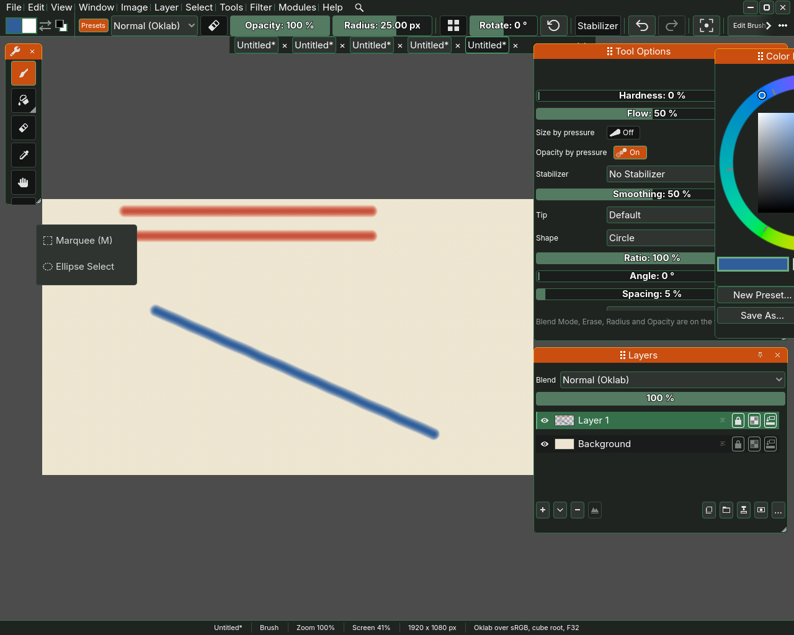
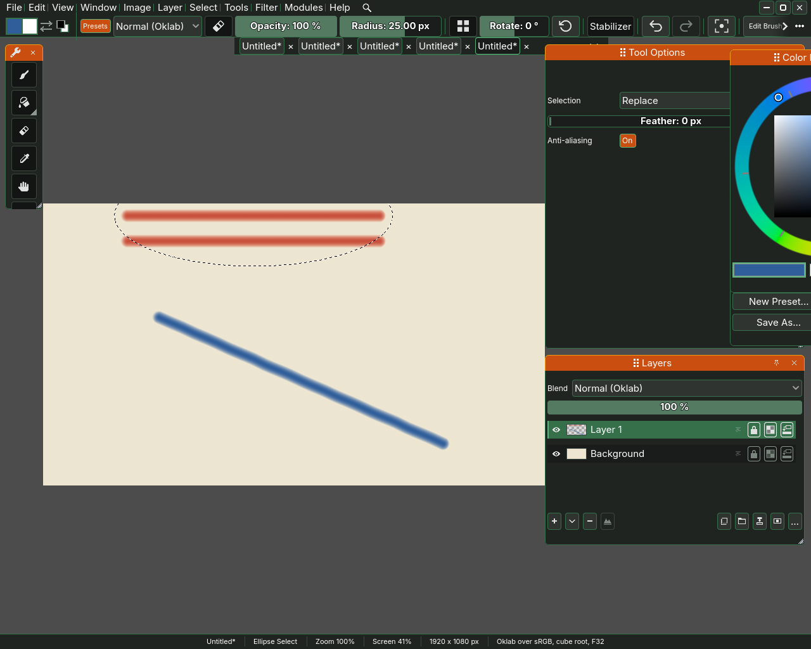
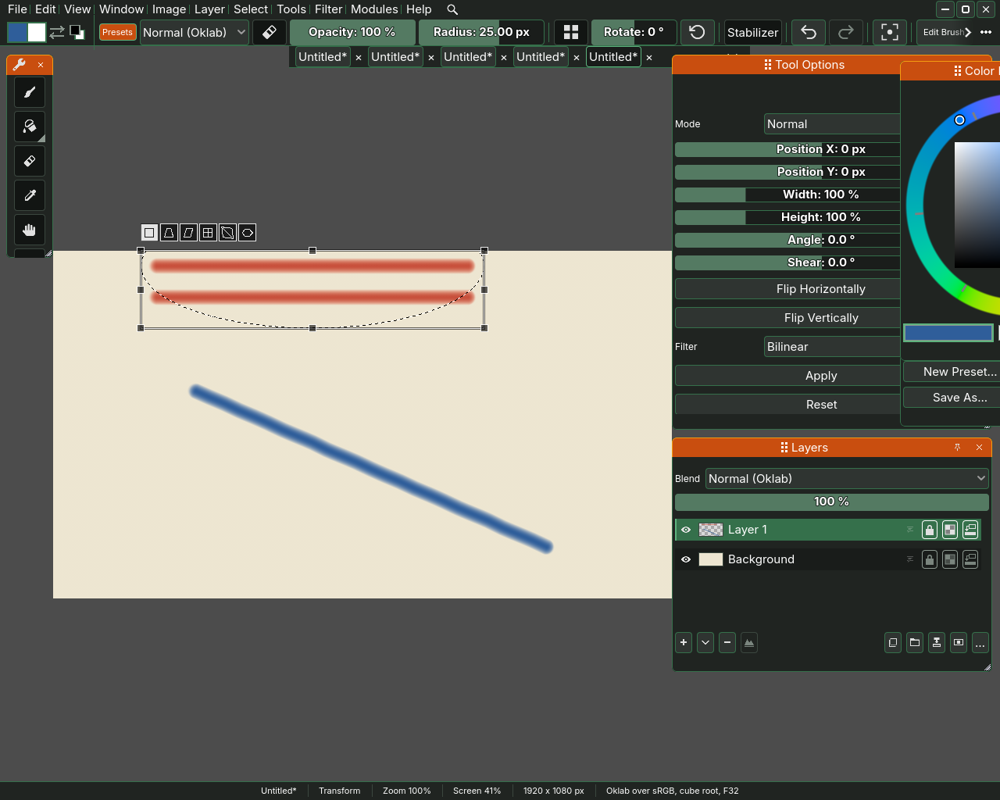
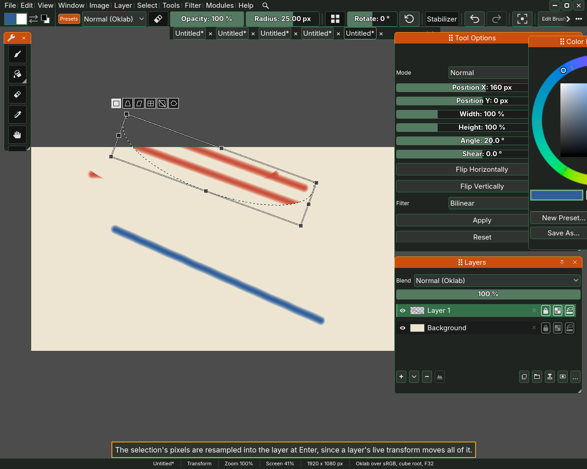

# Selections and the transform tool

A selection fences off part of the picture. While there is one, the brush,
the filters and the transform tool reach only inside it, and marching ants run
along its edge. Making a selection changes nothing in the picture, so it is not
a step you undo. This page covers the tools that make a selection, the Select
menu that changes one, and the transform tool that moves, scales and turns a
layer.

## The selection tools

The selection tools share one button in the toolbox. Press it with the right
mouse button and the other tools of the group open beside it:
**Marquee (M)**, **Ellipse Select (J)**, **Lasso (L)**, **Polygonal Lasso**,
**Magic Wand (W)** and **Patch**. The Tools menu picks them by the same keys.

- **Marquee** drags out a rectangle, and **Ellipse Select** an ellipse that
  fills the box you drag. With either, a drag that starts inside the selection
  moves its outline and leaves the paint where it is, and the pointer turns into
  the move arrows over it. To draw a new shape from inside an old one, deselect
  first or hold Shift as you press.
- **Lasso** draws the edge by hand. It follows the pointer while you drag and
  closes the shape when you let go. **Polygonal Lasso** sets a corner at every
  press and closes on a double click, on a press back on the first corner, or
  on Enter, and Escape throws the corners away.
- **Magic Wand** selects the paint around the point you press that is close to
  its colour. **Tolerance** says how close, 10 % to begin with, and **Merged**
  reads every layer as it is shown instead of the active layer alone.
- **Patch** fills the selection out of the paint around it, a soft blur that
  spreads inwards, which loses a blemish in a soft area. With no selection it
  patches a circle, as wide as its **Size**, where you paint. The **Patch**
  button runs it on the selection.

Every tool that makes a selection has two more options. **Selection** says what
the next shape does to the selection you have: **Replace** it, **Add** to it,
**Subtract** from it or **Intersect** with it, which keeps only what both hold.
Holding Shift while you drag adds, holding Alt subtracts and holding both
intersects, whatever the option says. **Feather** fades the edge of the shape
instead of cutting it off, so paint across that edge lands at part strength.
It starts at 0 px, a hard edge. Ellipse Select and both lassos have a third,
**Anti-aliasing**, on to begin with, which selects a pixel the edge crosses
only as far as the shape covers it, so a curve has no stair steps. The
Marquee's edges run along whole pixels and need none.

## The Select menu

- **All**, Ctrl+A, selects the whole canvas.
- **Deselect**, Ctrl+D or Ctrl+Shift+A, drops the selection, so painting
  reaches the whole layer again.
- **Reselect**, Ctrl+Shift+D, brings back the selection the last Deselect
  dropped, exactly as it was. It is dimmed while a selection stands, and a
  crop or a change of image size lets the dropped one go, since the picture
  moved under it.
- **Invert**, Ctrl+Shift+I, swaps what is selected for what is not.
- **Colour Range...** selects every pixel near a colour, anywhere on the
  canvas. Its window has the **Colour**, **Pick from canvas**, which puts the
  Eyedropper in your hand so that a click on the picture takes the colour, and
  gives you your tool and your foreground colour back when the window closes,
  **Fuzziness**, which says how far from the colour a pixel may be and still be
  chosen, **Sample merged**, which reads the whole picture as it is seen, and a
  **Mode** that replaces, adds to, subtracts from or intersects with the
  selection.
- **Feather...** softens the edge of the selection you already have over a
  radius you give in its window, **Border...** replaces the selection with a
  band along its edge, and **Grow...** and **Shrink...** move the edge out or
  in by that many pixels, so a wand selection that stopped short of a soft
  stroke's fringe can take it in. All four windows end with **Cancel** and
  **Apply**.
- **Quick Mask**, Alt+Q, lets you paint the selection itself instead of the
  picture. A tint covers what is not selected, and every brush edits the
  selection, light selecting and dark deselecting, until you press Alt+Q
  again or Escape.

## The transform tool

Pick **Transform** from the Tools menu, or press Ctrl+T, and a box with
handles appears around the selection, or around the paint on the active layer
when nothing is selected. Drag inside the box to move what is in it, drag a
corner or an edge handle to scale it, and drag just outside a corner to turn it.
When a drag leaves a handle under a docker, the view moves just far enough to
bring it back. Tool Options shows the same move as numbers you can type.

- **Mode** says what a handle drag means. **Normal** scales, **Shear** leans
  an edge over, **Perspective** moves a corner and its neighbour the mirror way
  along the edge you drag it along, so the top widens on both sides at once,
  and with Shift moves the one corner, and **Freehand** bends the picture
  through a grid of nine points, which are its handles. A drag between them
  moves nothing, so a move is made under Normal. Each cell of the strip over
  the box says what its mode does when the pointer rests on it.
- **Position X** and **Position Y** say how far it has moved, in pixels.
- **Width** and **Height** are in per cent of what was lifted.
- **Angle** turns it about the centre of the box, and **Shear** leans it off
  square. Ctrl and an edge handle shears under Normal, and Shift keeps the
  picture's proportions on an edge handle as on a corner.
- **Flip Horizontally** and **Flip Vertically** turn what is in the box over about
  its own middle. The Image menu flips and turns the whole picture, and the
  Layer menu flips the active layer.
- **Filter** says how the moved picture is read between pixels. **Nearest**
  keeps hard pixel edges and never makes a colour the picture did not have,
  and **Bilinear** blends neighbouring pixels for a softer result.

Nothing is written until you press **Apply** or Enter, which puts the move
into the layer as one step you can undo. **Reset**, or Escape, puts the pixels
back where they were.

## The crop tool

The crop tool (C) trims the picture to a box. The moment you pick it, the box
stands on the canvas's edges with a handle at each corner and side, so you
trim by pulling a side in. A drag anywhere else draws a fresh box, and a click
that does not move puts the box back on the canvas. With a ratio chosen in the
Tool Options docker, the box starts as the largest of that shape inside the
canvas, in its middle. Enter or the **Crop** button crops to the box as one
step you can undo, and the box then stands on the new canvas. A box still on
the whole canvas crops nothing. Escape puts the box back on the canvas.

Layers, which a transform works on one at a time, are on [Layers](05-layers.md).
