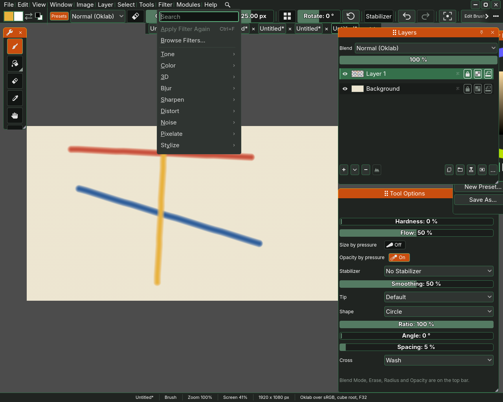
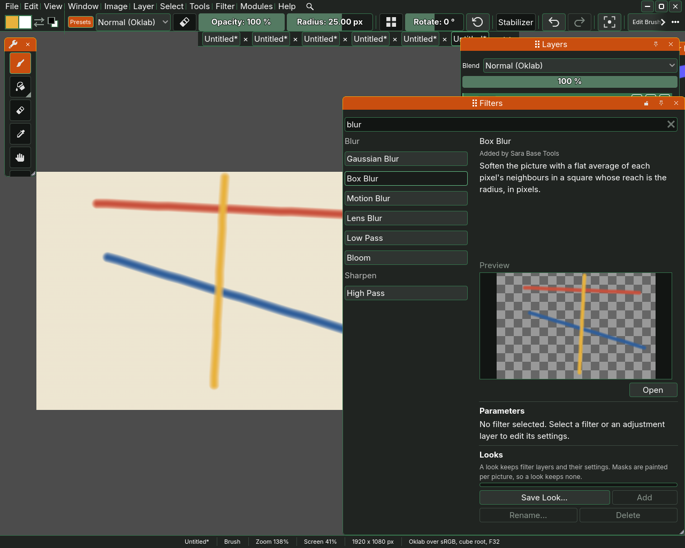
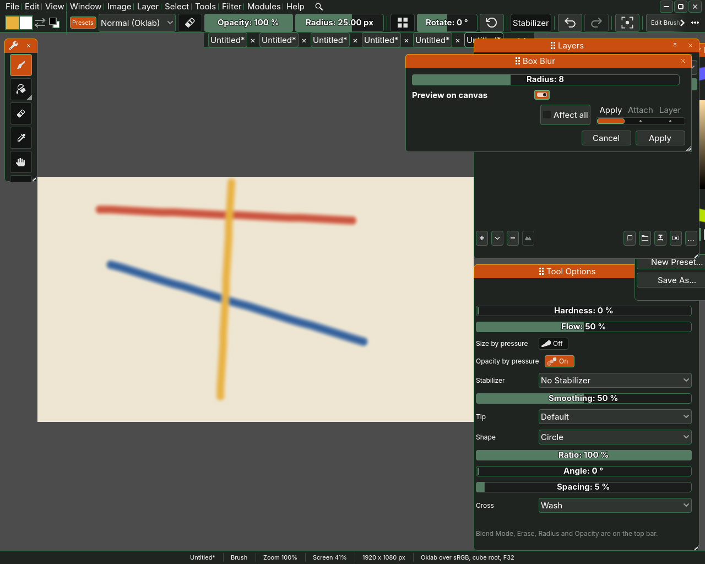
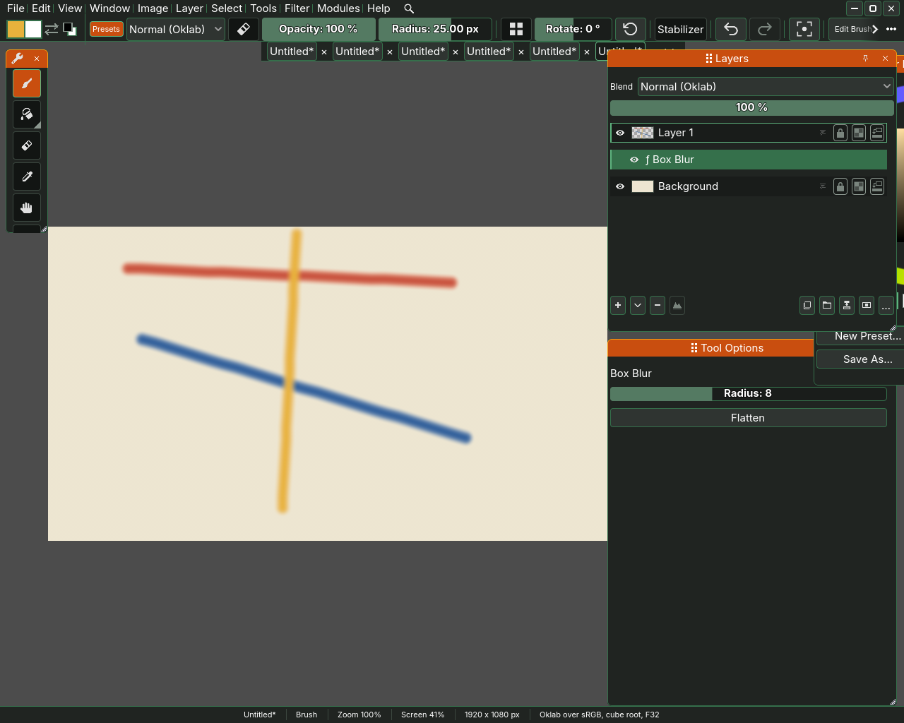

# Filters

A filter changes the pixels of the active layer all at once: it blurs them,
sharpens them, shifts their colours or adds noise. Sara's filters come from its
modules, so a module you install can add filters of its own, and they appear in
the same places as the built in ones. A filter can be written into the layer
for good, or attached to it, where it stays editable.

## The Filter menu

The **Filter** menu starts with **Apply Filter Again**, Ctrl+F, which runs
the filter applied last once more with the settings it had. Once a filter has
run, the row is named after it, such as Apply Box Blur Again, and before that
it is dimmed. Then comes **Browse Filters...**, then one row per kind
of filter, each opening the filters of that kind: **Tone**, **Colour**, **3D**,
**Blur**, **Sharpen**, **Distort**, **Noise**, **Pixelate** and **Stylize**.
Writing a filter of your own starts in the **Develop** section of the
**Modules** menu, whose **Copy the kernel prompt** puts on the clipboard the
rules a filter has to keep, ready to paste into a language model.

Two filters under Colour have nothing to set. **Invert** turns every colour
into its opposite, so black becomes white, and a second Invert gives the layer
back as it was. **Desaturate** takes every colour to the grey of its own
lightness. It is **Hue/Saturation/Lightness** with Saturation at nought, so to
take the colour only part of the way out, open that one instead. Attached to a
layer or held by an adjustment layer, Desaturate is a Hue/Saturation/Lightness
record listed under that name, and a double click on it opens that filter at
Saturation nought, ready to be turned part of the way. **Pixelate**,
under Pixelate, cuts the picture into square blocks of one colour each,
**Block size** pixels across. The blocks are laid from the top left corner of
the picture, so they line up however the layer was painted.

## Browse Filters

Browse Filters... calls up the **Filters** docker under the pointer, with
every filter in one list down its left, grouped under the same headings as the
menu. It goes back when the pointer leaves it, as a docker called up under the
pointer does, and Window, Filters opens it where it stays. Type in the search
box at the top to narrow the list, so blur leaves Box Blur, Gaussian Blur, Low
Pass, Motion Blur, Lens Blur and Bloom under Blur, and High Pass under
Sharpen. Pick a filter to see its name, the module it came from, such as Added
by Box Blur, a sentence on what it does and a preview of it on your picture.
**Open** opens that filter's window. Under it, **Parameters** holds the
settings of a filter or an adjustment layer picked in the Layers docker, and
**Looks** keeps a group of filter layers under a name: **Save Look...** keeps
the active group, and **Add** puts the look picked in its list back above the
active layer.

## A filter's window

Every filter opens in a window of its own, named after it, at the right edge
of Sara's window over the dockers, so the strokes it changes stay in sight. At
the top come the filter's own settings, such as **Radius** for Box Blur, and
below them a small picture of the result, the **Preview**. The **Preview on
canvas** switch shows the filter on the canvas instead while you move its
settings, which is not a step you undo, and the small picture steps aside
while it is on. Under it a slider with four stops, **Apply**, **Attach**,
**Layer** and **Picture**, says what the Apply button does, and it starts on
Apply.

On Apply, the **Apply** button writes the filter into the active layer as one step you
can undo. On Layer it adds an adjustment layer holding the filter above the
active layer. On Picture it attaches the filter to the whole picture, and the
Layers docker lists it at the top with an eye of its own.
**Cancel** closes the window and leaves the layer as it was, preview and all.

## Attached filters

Slide the window's three stops to **Attach** before you press Apply and the
filter is attached to the active layer instead of written into it. It then shows in the Layers docker as a row
of its own under its layer, such as **ƒ Box Blur**, and the layer's pixels stay
as you painted them underneath.

- The eye on the filter's row switches the filter off and on again, and each
  switch is a step you can undo.
- Press the row to pick the filter, and Tool Options shows a **Flatten**
  button, which writes the filter into the pixels under it and takes it off, as
  one step.
- Double click the row to open the filter's window again with its settings as
  you left them, and change them.
- The More menu over a picked filter holds **Delete Filter**, the mask rows and
  **Mask from Colour Range...**, so a filter can have a mask of its own that
  says where it acts.

To be rid of a filter and its effect, pick its row and press the **-** button
under the list, or choose **Delete Filter** from the More menu. The filter comes
off, the layer and its pixels stay as they were, and the step can be undone.
With a layer's row picked, the same **-** deletes the layer, and its hover says
which of the two it will do.

Layers, masks and the More menu are on [Layers](05-layers.md), and selections
are on [Selections and the transform tool](06-selections-and-the-transform-tool.md).
