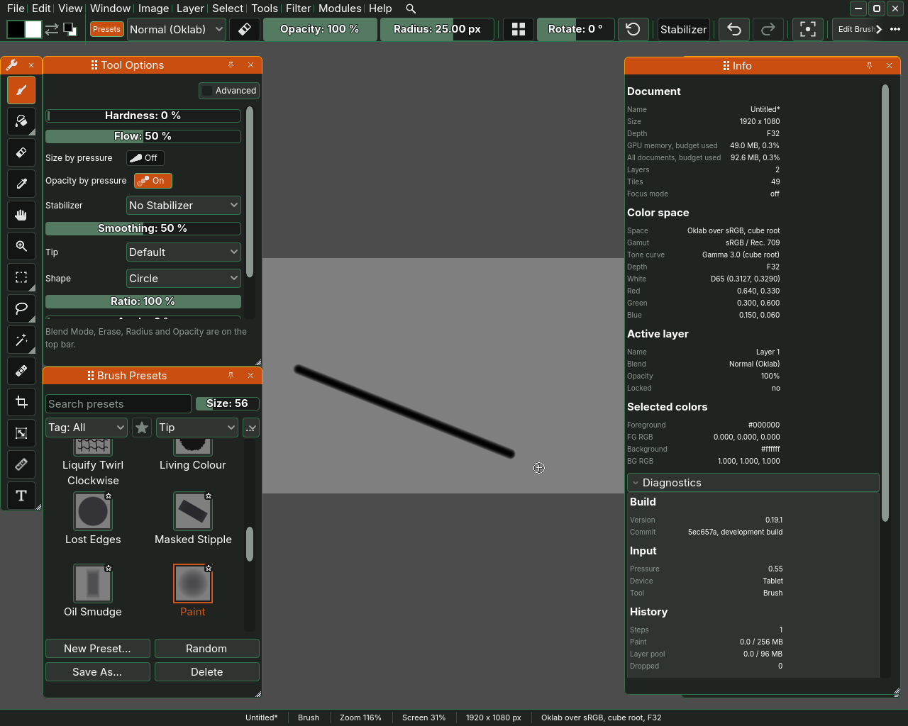
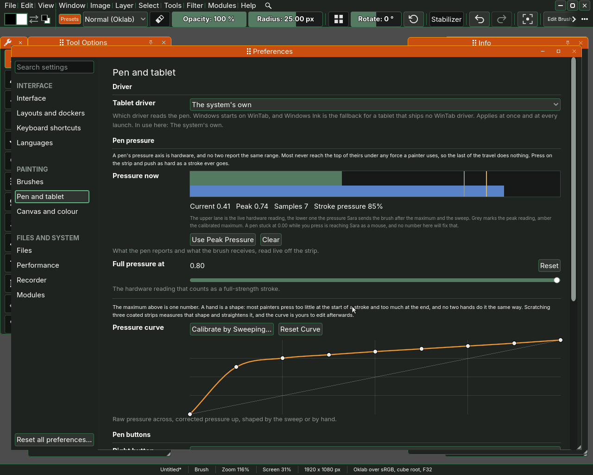
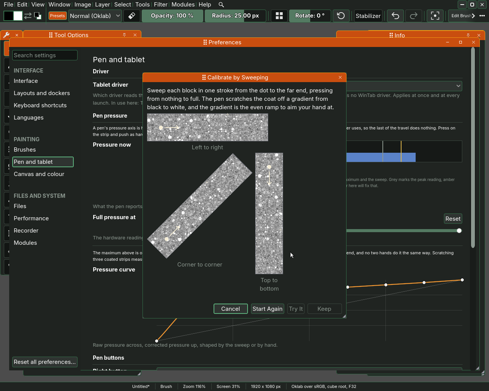
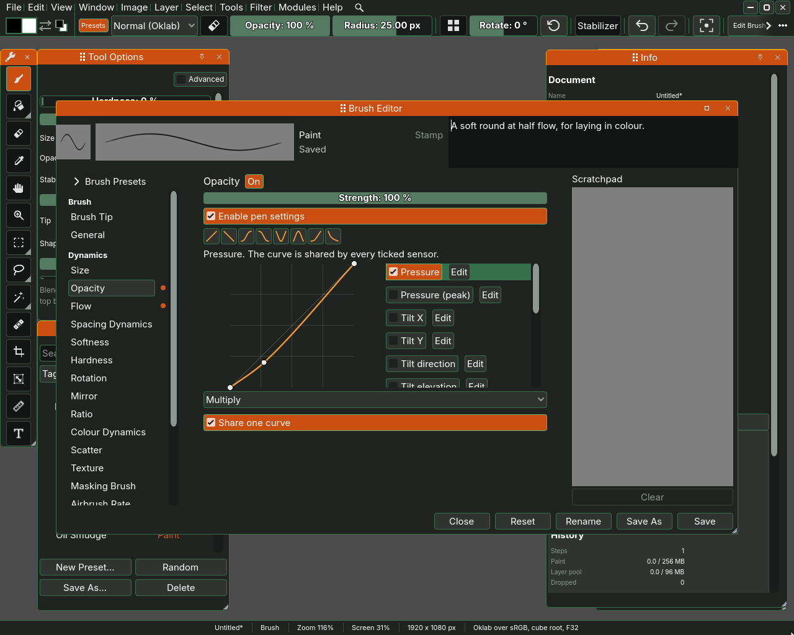

# The tablet

Sara is made to be painted with a pen. It reads how hard you press, how far
the pen leans, which end touches the tablet and which of its buttons you
hold, and a brush can answer to each of them. A picture cannot show a pen, so
this page shows what Sara reads from it and says in words what the pen does.

## What Sara reads from the pen

Window, Info opens the **Info** docker, and its **Input** section, in the
**Diagnostics** fold a press on its title opens, says what Sara hears from the
pen as you use it. **Pressure** is how hard you press, from 0.00 to 1.00,
**Device** says **Tablet** for a pen and **Mouse** for a mouse, and **Tool**
names the tool in your hand. If Device says Mouse while you paint with the
pen, Sara is getting the pen as a mouse, and no setting in Sara brings its
pressure back. The tablet's driver is where to look.

## Pressure

Pressing harder makes the brush stronger. The **Tool Options** docker has
two switches for it. **Opacity by pressure** is on for a new brush, so a
light touch lays a thin coat and a hard one a full coat. **Size by
pressure** is off, and turning it on makes a light touch paint a thin line
and a hard one a wide line. With both off the brush paints the same however
hard you press. What else pressure changes, the flow or the spacing, is part
of the brush, set in its editor as the last section of this page says.

## The eraser end

With the brush in hand, turn the pen over and its eraser end rubs out what
it crosses, with the same brush tip. Turn it back and the tip paints again.

## The pen's buttons

The buttons on the pen's barrel reach Sara as the mouse buttons they stand
for in the tablet's driver.

- **The right button**, with the brush in hand, opens the **Brush Presets**
  docker by the pen, and a second press puts it away again.
- **The middle button**, held while you drag, moves the view, as the Pan
  tool does.
- **The mouse's middle button**, the wheel press, has a row of its own and
  moves the view by default. It is separate from the pen's middle button, so
  the pen's can hold the eraser while the wheel still pans.

The **Pen buttons** section of the **Pen and tablet** page binds each of them to
something else, and the line under each row says which button of a usual
pen it is: the right button is the barrel's lower one, nearer the tip, and
the middle one the upper, where the driver sends it. Which barrel button
the driver sends as which is set in the tablet's own settings. Sara tells a
pen's middle press from a mouse's by whether a pen moved the pointer last, and
that needs a pen that reports its tilt. The **Mouse middle button** row binds
the wheel press and offers the same choices.

## Calibrating the pressure

Help, Tablet Settings... opens Preferences at the **Pen and tablet** page. Its **Pen
pressure** section is where Sara learns your pen and your hand.

- **Pressure now** is a strip to press on. Push on it as hard as a stroke
  ever goes. The readout under it gives the current pressure, the peak so
  far, the number of samples and the stroke pressure, which is what the
  brush is sent. The upper lane is what the
  pen reports and the lower one what Sara hands the brush. Grey marks the
  peak reading and amber the calibrated maximum.
- **Use Peak Pressure** makes the peak reading your full pressure, and
  **Clear** forgets the readings.
- **Full pressure at** is the pressure that counts as pressing fully. Most
  pens never reach the top of their range, so the last of the travel does
  nothing until this is set lower. **Reset** puts it back.
- **Pressure curve** straightens how your hand presses. Click on the curve
  to add a point and drag a point off it to remove it. **Reset Curve** makes
  it straight again.

**Calibrate by Sweeping...** opens a window with three blocks, **Left to
right**, **Top to bottom** and **Corner to corner**, each under a glittering
coat. Sweep each block in one stroke from its dot to the far end, pressing
what feels to you like an even ramp from nothing to full. The pen scratches
the coat off as fast or as slowly as you go, and under it lies a gradient
from black to white, the even ramp to aim your hand at. A sweep that starts
at the far end, stops short or presses hardest too early is not counted, and
the line above the blocks says why. Sara then shows the curve that would make
your sweeps even, with your hardest press at four fifths of full, so you can
still press harder for more. **Try It** puts the coats back and paints your
sweeps through the new curve, black at nothing and white at full, so a curve
that fits your hand paints the same gradient again. **Keep** makes it your
pressure curve and **Start Again** puts the coats back and forgets the curve.

## The tablet driver

On Windows, a tablet speaks through one of two drivers, and the **Tablet
driver** row at the top of the **Pen and tablet** page of Preferences chooses which
Sara listens to: **WinTab**, **Windows Ink**,
the system's own choice, or none. If the pressure stays at 0.00, try the
other one. On Linux the row has one choice and there is nothing to set.

## Tilt, speed and the rest

What a brush does with the pen is set in the brush editor, which **Edit
Brush** in the top bar opens. Each page of it, such as **Opacity** or
**Size**, has a list of sensors, and ticking one makes that page follow it:

- **Pressure** and **Pressure (peak)**, how hard you press and the hardest
  you have pressed so far in the stroke.
- **Tilt X**, **Tilt Y**, **Tilt direction** and **Tilt elevation**, how
  far the pen leans, and to which side.
- **Speed**, **Drawing angle** and **Distance**, how fast the stroke goes,
  which way and how far it has come.
- **Time** and **Fade**, how long the stroke has lasted.
- **Fuzzy per dab** and **Fuzzy per stroke**, chance.
- **Depletion**, the paint running out along a stroke.

**Rotation** is dimmed, because Sara is told nothing about the pen turning
in your fingers and it would read zero at every angle.

Keys and the rest of Preferences are on
[Shortcuts and Preferences](10-shortcuts-and-preferences.md).
