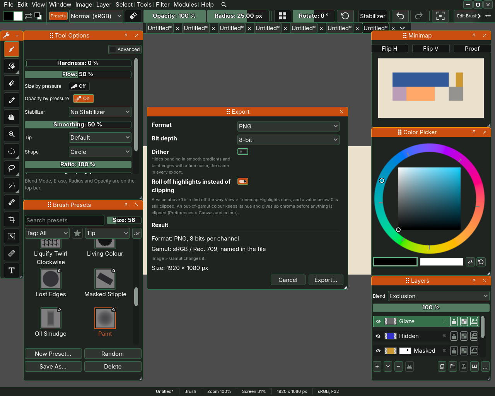
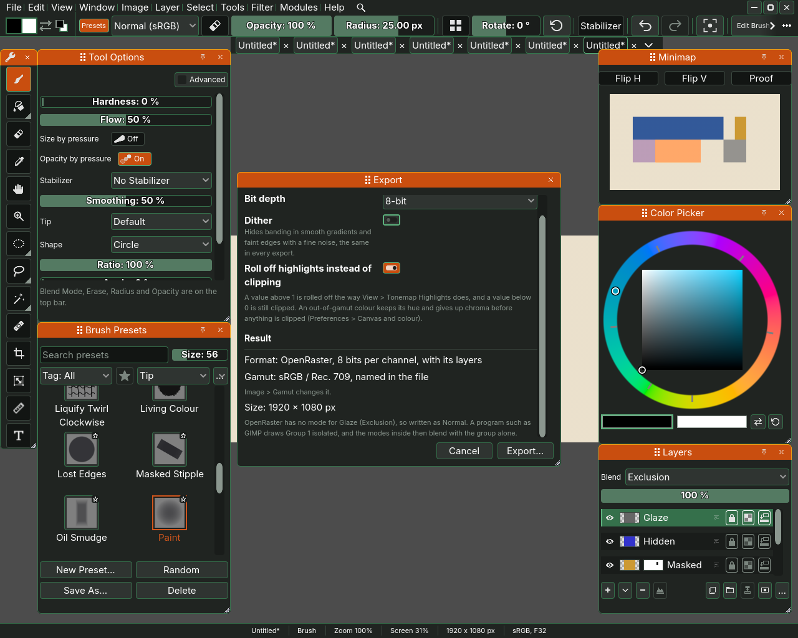

# Saving and exporting

Sara keeps a picture in a file of its own, the `.sad` file, which holds
everything you made. To give the picture to another program, you export a
copy in one of five formats, and each keeps some of the picture and drops
the rest. This page says which, as read off one picture exported to each.

## Saving

The **File** menu saves and opens.

- **Save**, Ctrl+S, writes the picture back to its own `.sad` file. A
  picture that has no file yet asks where to put one.
- **Save As...**, Ctrl+Shift+S, writes it to a new file you name.
- **Open File...**, Ctrl+O, opens a `.sad` file, or a picture from another
  program as a new document. **Import Picture...** brings a picture in as a
  layer of the one you have open.

A `.sad` file keeps the picture as you left it: every layer with its name,
blend mode, opacity and mask, the groups, the hidden layers, and colours
brighter than white or darker than black, which painting in Sara allows.
Close it, open it again and nothing has changed.

## Saving without thinking about it

The **Files** page of Preferences has a **Saving** section.

- **Previous versions kept** is how many older copies Sara keeps beside the
  file when you save, as `.sad1`, `.sad2` and so on. 0 keeps none.
- **Autosave every** saves the picture every so many minutes, once you have
  stopped painting for a second. 0 turns it off.
- **Autosave writes the working file** chooses where autosave writes. Off,
  it writes a copy called `<name>.autosave.sad` beside your file and offers
  it the next time Sara starts. On, it saves
  your file itself and keeps the version before as `.sad1`.

## Exporting

**File**, **Export...** opens the export window. Pick a **Format**, and
the lines under it say what that format keeps. Below them, the window says
which gamut the file will be named for, and the size of the picture.
**Export...** asks where to write the file.

Each format has options of its own.

- **Bit depth**, for PNG and OpenRaster 8-bit or 16-bit, and for TIFF
  16-bit integer or 32-bit float.
- **Dither**, for the files of 8 bits a channel, JPG, and PNG and OpenRaster
  at 8 bits. Off until you tick it, and it stays as you left it. Ticked, a
  fine noise, the same in every export, hides the bands a smooth gradient or
  a faint soft edge would show at 8 bits, and the result line says
  "dithered".
- **Roll off highlights instead of clipping**, for the formats that would
  clip, PNG, JPG, OpenRaster and the 16-bit TIFF. A colour brighter than white is bent back under white, the way View, Tonemap
  Highlights shows it, instead of being cut flat.
- **Quality**, for JPG, from 0 to 1. Lower makes a smaller file that looks
  worse.
- **Transparent areas**, for JPG, which holds no transparency: what is
  transparent on the canvas becomes White, Black or the colour on the swatch.
- **Half precision (16-bit)**, for EXR, which makes a smaller file that
  keeps a little less detail.

The **Author** row, in the **Exporting** section of the Files page of
Preferences, is the name an exported file carries as its author.

## What each format keeps

Every format flattens the picture into what you see, with hidden layers left
out, except OpenRaster, which keeps the layers.

- **PNG** keeps the picture at 8 or 16 bits a channel, with transparency,
  the author, the date, the name Sara and the gamut. Colours brighter than
  white or darker than black are clipped, or rolled off if you ask. Almost
  every program opens it.
- **JPG** keeps the picture at 8 bits a channel and the gamut. It drops the
  transparency, the author and the date, clips colours past white, and
  loses a little detail each time, more at a lower quality. It is the
  smallest file.
- **EXR** keeps every value as a floating point number, colours past white
  and below black included, and the transparency. It carries no author, no
  date and no gamut, so the program that opens it has to be told the gamut.
- **TIFF** at **32-bit float** keeps every value, like EXR, and carries the
  author, the date and the gamut as well. The file is large. At **16-bit
  integer** it keeps the author, the date and the gamut and clips colours
  past white, or rolls them off if you ask. Sara opens a TIFF again, its own
  at either depth and one from another program saved uncompressed or with
  zip compression.
- **OpenRaster** keeps the layers, for a program that paints in layers too.
  Each layer is its own PNG, at 8 or 16 bits, with its name, opacity and
  whether it is hidden, and each group is kept as a group with its opacity.
  A group that passes through is written at full opacity, its own opacity
  moved onto each of its layers, which is how Krita and MyPaint read a group
  that passes through. GIMP draws every group on its own, so a blend mode
  inside one reaches only the group there, and the window names the group.
  The file carries a flattened copy and a small preview as well, and each
  layer carries the author and the gamut. A layer's mask and filters are
  painted into its pixels, as you see them, while a group's mask and filters are left out. A
  blend mode OpenRaster has no name for is written as Normal, and colours
  past white are clipped, or rolled off if you ask.

What OpenRaster cannot keep of the picture in hand, the window says in a line
before you export, such as **OpenRaster has no mode for Glaze (Exclusion), so
written as Normal.**

## Which to choose

- To keep working on the picture, save it as `.sad`.
- To show it to people, export PNG, or JPG where a small file matters more.
- To carry on in another painting program with the layers, export
  OpenRaster.
- To grade it or print it with every value intact, export EXR or 32-bit
  TIFF.

Keys and the rest of Preferences are on
[Shortcuts and Preferences](10-shortcuts-and-preferences.md), and the pen on
[The tablet](08-the-tablet.md).
