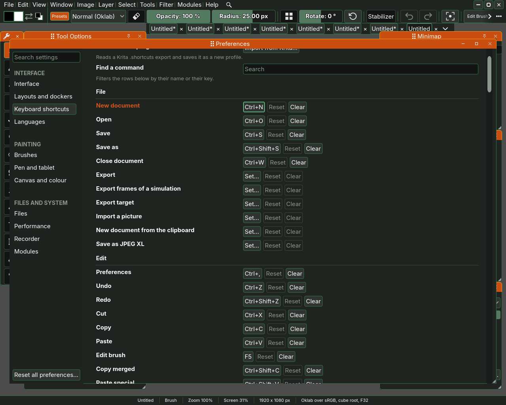
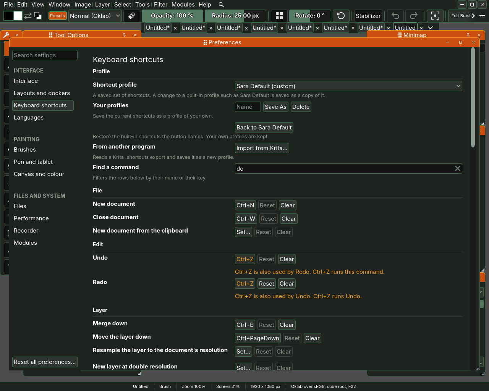
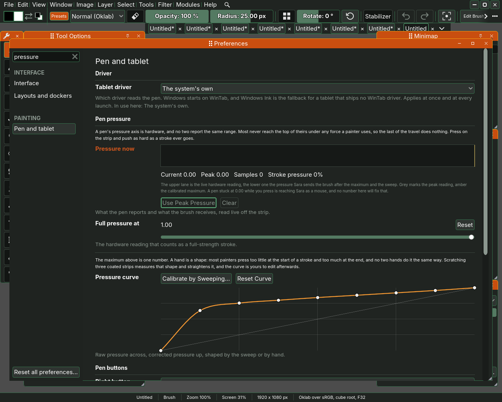

# Shortcuts and Preferences

Almost everything Sara does has a key, and every setting that is not about
the picture lives in one window, Preferences. This page says where to find
the keys and how to change them, and what each page of Preferences is for.

## The keys

**Help**, **Keyboard Shortcuts** opens Preferences at the **Keyboard
shortcuts** page, which is Sara's list of every key it answers to. The rows
are grouped the way the menus are, File, Edit, Image, Select, Layer, Fill,
Filter, Tools, Brush, Colour, View, Window, Modules, Help, Dockers and
Interface, with **Gestures** at the end for what the mouse and the pen do.
Every row of every menu is there, so a command that comes with no key can be
given one.

The keys a painter reaches for most:

- **B** the brush, **E** the eraser, **I** the eyedropper, **Q** pan, **M**
  the marquee, **J** the ellipse selection, **C** crop, **G** the gradient,
  **L** the lasso, **W** the magic wand and **Ctrl+T** transform. The fill
  has no key of its own, **Shift+G** steps from it to the gradient.
- **Shift with a tool's key steps through that tool's group**, the tools that
  share its button in the toolbox. **Shift+M** goes through the selection
  tools, **Shift+L** through the lassos, and a tool that is alone in its
  button is just picked. The step wraps after the last tool, and each step
  is a row on the Keyboard page you can rebind.
- Hold **Alt** for the eyedropper and **Space** to pan, and let go to have
  your tool back.
- `]` or **S** makes the brush larger and `[` or **A** smaller. **Shift**
  with a left drag on the canvas sizes it by hand, a pixel of radius on
  screen for each pixel the pointer moves sideways.
- **X** swaps the two colours and **D** resets them.
- **Ctrl+Z** undoes and **Ctrl+Shift+Z** redoes.
- **Ctrl+Plus** and **Ctrl+Minus** zoom, **Ctrl+0** resets the zoom the way
  the **Reset zoom to** row says, and **Ctrl+1** shows actual pixels, one
  pixel of the picture on one pixel of the screen. `Ctrl+[` and `Ctrl+]` turn
  the view and **H** flips it. **F** fits the picture between the dockers,
  which reads Zoom 100 percent, **V** centres it and **R** turns it upright
  again.
- **Tab** hides every docker but the ones pinned with the pin on their
  drag bar, and pressing it again brings them back. Sara always starts with
  Tab off, so a close under it brings the dockers back at the next start,
  where they stood. Choosing the default layout in the Window menu brings
  them back at once.
- **F1** opens this manual, **F9** the Info docker, and **F11** makes the
  window fill the screen.
- **Ctrl+Alt+1** to **Ctrl+Alt+0** pick the brushes in the ten brush
  slots.
- **F3** searches every command, **Shift+Q** opens your Quick Favourites
  and **Shift+R** runs the last command again. Four habits from Blender,
  below, says more.

The **Gestures** at the end are fixed. The wheel zooms about the pointer,
dragging with the middle button pans, Shift with a left drag on the canvas
sizes the brush, Shift with a middle drag or with Space and a pen drag turns
the view, Ctrl with a middle drag zooms it gently about where the drag began,
up or right zooming in, and on a docker, Alt with the left button moves it and Alt with the
right button resizes it.

## Changing a key

Click the key shown on a row and press the key you want instead. Escape
leaves the row as it was. **Reset**, at the end of each row, puts that row
back, and **Clear** beside it takes every key off the row. A row with no key
reads **Set…** where its key would be.

If the key you press already belongs to another row, Sara asks at once and
names the command that has it. **Use for** gives the key to the row you are
changing and takes it off the other, which keeps its other keys. **Share**
leaves the key on both, and **Cancel** leaves both rows as they were.

A shared key is marked in another colour on every row that has it, and a
line under each row names the other commands on that key and says which one
a press of it goes to. Sara asks some commands before others, so a key shared
by two rows does only one of the two things.

The top of the page keeps whole sets of keys, which Sara calls profiles.

- **Shortcut profile** chooses one: **Sara Default**, **Krita** or
  **Photoshop**. Sara Default is the set Sara comes with, and it stays as
  it came. Keys you change are kept as a profile of your own with Save As.
  Under Photoshop the dockers leave Shift and a letter, which in Photoshop
  steps through a tool's group, so a Photoshop habit never hides a docker.
  Sara Default does the same for the Toolbox, the Colour Picker, Recent
  Presets and the Pop-up Palette, which hold no Shift key of their own.
  They open from the **Window** menu and from **Alt+Shift** with B, C, E
  and W.
  **Layers** is on **F7**, the **Colour Picker** on **F6** and **Info** on
  **F8**, Photoshop's own panel keys. The other dockers have no key there
  and open from the **Window** menu.
- **Your profiles**: type a name and **Save As** keeps the keys as they are
  now under it. **Delete** forgets the chosen one.
- **Back to Sara Default** puts every key back to the set Sara comes with.
  The button names the set it goes back to: with Krita chosen it reads
  **Back to Krita**. Your own profiles are kept.
- **From another program**: **Import from Krita...** reads the file Krita
  writes when you export its shortcuts, and saves it as a new profile.
- **Find a command** narrows the rows to the ones whose name or key has
  what you type. Typing ctrl+j finds the command on Ctrl+J, shift finds
  every key held with Shift, drag finds the gestures that are drags, and a
  single letter finds the commands on that key. When no row has it, the
  page says Nothing matches.

## Four habits from Blender

A hand that knows Blender reaches for four things to keep the menus out of the
way, and Sara answers all four the same way. Blender is where they come from,
each on the key it has there: **Menu Search** on **F3**, **Quick Favourites**
on **Q**, **Repeat Last** on **Shift+R** and **Assign Shortcut** on a menu
row's right click. Sara keeps three of those keys and moves one, Quick
Favourites to **Shift+Q**, because **Q** alone is the Pan tool here. The ideas
are Blender's and none of its code is.

**F3 searches every command.** A field opens at the pointer with every command
Sara has listed under it, each with the menu it sits in, Edit › Undo, and its
key at the right. Type part of a command's name or of its menu and the list
narrows to the rows that have it, with the first one marked. The arrows move
the mark and **Enter** runs the marked command. A command a module brings is
listed too, under its own name when no menu holds it, and a filter is listed
under its section of the Filter menu. A command that cannot run now, Apply
Filter Again before any filter was applied, is listed dimmed and does not
run. The last three rows you picked open the list again, newest first under
the heading Recent and above every row as before, so the filter you reach for
all afternoon is one **F3** and an **Enter** away, and Sara keeps them when it
closes.

**Shift+Q opens your Quick Favourites.** Right-click any row of any menu and
choose **Add to Quick Favourites**. Shift+Q then opens a short menu of the
rows you added, at the pointer, in the order you added them, each with its
key. Right-click one of them, or its row in the menu it came from, and
**Remove from Quick Favourites** takes it off. The list is kept with the
shortcut profile, so the Photoshop set and your own set each have their own.
Sara Default stays as it came, so the first favourite you add to it starts a
profile of your own, Sara Default (custom), the way the first key you change
does. From the keys alone, the **Menu** key on the row the arrows marked
opens the same choice a right click does.

**Shift+R repeats the last command.** Whatever you last ran from a menu, a
key, the search or your favourites runs again. A filter runs again with the
settings you last applied, without its window, the way **Filter**, **Apply
Filter Again** does. Undo and redo are never the last command, so Shift+R
after an undo runs the command from before the undo, and Shift+R itself is
never the last command either. **Edit**, **Repeat Last** is the same command,
dimmed until there is something to repeat.

**Assign Shortcut from the menu.** The same right click offers **Assign
Shortcut...**. A window names the command and waits for the next key you press,
which becomes that command's key in the profile in use and replaces the one
it had. Escape leaves it as it was. If another command already has the key,
Sara asks first and names it, "Ctrl+Z is already used by Undo. Use it for Copy
merged instead?", and **Use for Copy merged** takes the key off that command
and gives it to this one. The Keyboard shortcuts page lists the new key on that row.

Two keys moved to make room. **Quick Mask** is **Alt+Q** now, the same letter
under another key, and the **Recorder** docker is **Shift+X**, with
**Alt+Shift+X** to summon it. They had Shift+Q and Shift+R in all three
profiles.

## Preferences

**Edit**, **Preferences...**, or Ctrl and the comma key, opens Preferences. **Help**
opens it at the page for the display, the tablet or the keys, from
**Display Settings...**, **Tablet Settings...** and **Keyboard Shortcuts**.
The pages are listed down the left in three groups, by what you are doing,
and the field at the top searches all of them: type a word and the list
keeps only the pages that have it.

**Interface**

- **Interface**, the page Preferences opens on, with what you are likely
  to change first at the top: the **UI scale**, the **Font size** and the
  interface font, the **Colour theme** with **Edit colours...** beside it,
  which opens every colour of the theme and palettes of your own, **Pen
  pressure**, which says where full pressure is now and whose **Calibrate
  the pen...** opens **Pen and tablet** at the calibration, **Undo steps**,
  how many fills, gradients and crops Ctrl+Z can walk back, **Advanced
  options**, which shows the options a tool marks as advanced in the Tool
  Options docker, and what shows while Sara starts: the welcome window, and
  a picture of the last session.
- **Layouts and dockers**: the docker layouts, with **Dockers inside the
  main window** under them, which turned off makes every docker and dialog
  a window of its own, the settings all the dockers share, each set once,
  and a line for each docker.
  Under **Every docker**, **Hide button** puts a button on every docker's
  drag bar that closes it, and **Maximize button** one beside it that
  fills the window with the docker and puts it back. Under **Summoned
  dockers**, **Summoned docker delay** and **Summoned docker distance**
  say how long the pointer stays away from a docker called up under it by
  its key, and how far it goes, before the docker goes back.
  Under **Top bar**, **Window button position** and **Window button
  style** say where the minimize, maximize and close buttons sit and how they
  look, and **Customize...** on the bar's line chooses which menus and
  controls the top bar shows, their order, and whether the list behind the
  three dots holds the rest.
  Under **Each docker**, a docker's line names the parts it hides.
  **Customize...** on it chooses which of the docker's parts are shown, and
  their order, and **Options...**, on the Colour Picker, Reference and
  Toolbox, holds that docker's own settings. **Back to Layouts and
  dockers** at the top of either returns to the line.
- **Languages**: the language Sara speaks, English or one a module brings,
  which changes at once, and under it each translation the modules
  registered.
- **Keyboard shortcuts**: the keys, as above.

**Painting**

- **Brushes**: the preset each of **Slot 1** to **Slot 10** holds, which
  Ctrl+Alt+1 to Ctrl+Alt+0 load, **Pop-up palette**, off at first, which
  lets Alt+Shift+W show the ten slots round a colour wheel under the
  pointer, and **Import Krita presets...**, which reads a Krita `.kpp`
  preset or a `.bundle`.
- **Pen and tablet**: everything about the pen, on [The tablet](08-the-tablet.md):
  the **Tablet driver**, the pressure, what each of the pen's buttons does,
  Sara's own pointer for a pen that has none, and **Cursor prediction**.
- **Canvas and colour**: how the canvas is shown, which never changes the
  picture. The view transform, the highlight roll-off, gamut mapping, the
  display exposure, the gamut of your monitor and the proofs. Under **Zoom**,
  **Reset zoom to** is what Reset Zoom shows and how a new or opened picture
  opens: **The whole picture** at the **Size** beside it, 90 percent by
  default, which leaves a margin round it, 100 for an exact fit and more to let
  it overflow a little, or **Actual pixels**.

**Files and system**

- **Files**: the saving and exporting settings on
  [Saving and exporting](09-saving-and-exporting.md), what happens to a
  picture you drop or paste that is not the canvas's size, and at the foot
  the **Settings folder**, where Sara keeps your settings, layouts and
  profiles.
- **Performance**: **Settings for a weak GPU**, whose **Apply** sets the
  frame rate while painting, the thumbnails and the undo depth for a graphics
  card that struggles, and those three one by one.
- **Recorder**: where the timelapse writes its frames, how long Sara waits
  after a stroke before taking one, and how large it may grow.

A module that brings settings of its own adds a page to the group it names,
or to **Files and system**. **Reset all preferences...**, under the list,
puts every setting on every page back to its default, and asks first.
**Help**, **Colour Spaces...** shows the colour spaces Sara knows, in a
window of its own.

Hold Alt and double click on a docker to open Preferences on its
line of **Layouts and dockers**.

The window itself is on [The window](01-the-window.md).
