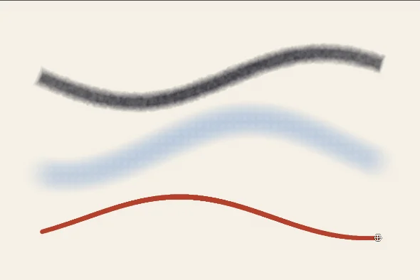

# stamp-brush

A Sara module: the stamp brush engine, a stroke laid as dabs of a tip, and the
eraser that shares it.

Each dab is a copy of the brush's tip, placed along the path of the pen at a
spacing, and the pen's pressure, tilt and speed can change its size, opacity and
angle. The picture above shows the Charcoal, Wash and Inked Pen presets, drawn
in Sara with one stroke each.

## Using a Krita brush

Sara reads Krita's brush presets and bundles, so a brush made there is
available as a Sara preset:

1. Open Preferences and go to the Brush Presets page.
2. Press **Import Krita presets...**.
3. Choose a `.kpp` preset or a `.bundle` file. A bundle brings all its presets.

The imported brushes appear in the Brush Presets docker, where they can be
renamed, tagged and saved like any other preset. Not every Krita setting has a
counterpart in Sara, and a setting without one is left out.

## Where it comes from

The engine follows the behaviour of Krita's stamp brush, written from the
published sources rather than copied. [PROVENANCE.md](PROVENANCE.md) says which
parts are ports, which are independent and under which licence.
